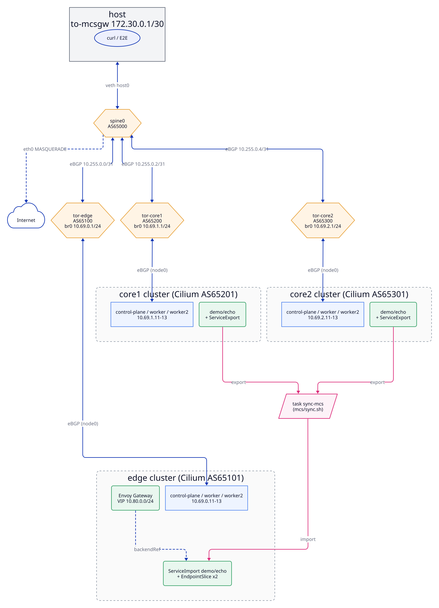

# mcs-gateway: Envoy Gateway + MCS + Cilium KPR on kind × containerlab

## Summary

kind クラスタ 3 つ（L7LB 用の **edge** × 1、アプリ用の **core** × 2）と FRR の spine/ToR を containerlab でつなぐ。全体を、BGP でつながるフラットな L3 ネットワークとして手元に構築する。

- 全クラスタで Cilium（kube-proxy replacement、DSR/Geneve、Maglev、multi-pool IPAM、BGP Control Plane v2）が動く。
- edge の Envoy Gateway は、MCS（kubernetes-sigs/mcs-api + CoreDNS multicluster）の `ServiceImport` を backend にする。リクエストは core クラスタの Pod へトンネルなしで直接振り分けられる。

---

## Motivation

- **edge/core 分離アーキテクチャの検証環境がない。** 参考にする neco-apps-lite は単一クラスタで、L7LB（Contour）とアプリが同じクラスタにある。L7LB を専用の edge クラスタに切り出し、複数の core クラスタに振り分ける構成を、手元で試せる環境が欲しい。
- **ClusterMesh に依存しないマルチクラスタのサービスディスカバリを試したい。** 標準 API の MCS（ServiceExport/ServiceImport）と、Envoy Gateway の ServiceImport backend を組み合わせる。こうすると、CNI 固有の機能に頼らずにクラスタをまたぐ L7 ルーティングが成り立つかを確かめられる。
- **Cilium の LB データパスを BGP ファブリック上で確かめたい。** KPR、DSR (Geneve)、Maglev、multi-pool IPAM を、実ネットワークに近い spine/ToR 構成の上で、クラスタをまたいで動かす。そのうえで、経路広報、DSR の応答経路、MTU などの挙動を観察できるようにする。
- **再現性と段階的な検証。** neco-apps-lite の `network/` は、Coil、BIRD、ノード上 BIRD を含むため構成が重い。それを単純にした構成を、Taskfile と aqua で 1 コマンドで冪等に起動できるようにする。さらに、各段階をテストで確かめながら積み上げられるようにする。

---

## Goals / Non-Goals

### Goals

1. 3 つの kind クラスタ（edge、core1、core2）と FRR の spine/ToR を、1 つのコマンド（`task start`）で containerlab 上に冪等に構築できる。
2. 全クラスタで Cilium の KPR、DSR（Geneve）、Maglev、multi-pool IPAM、BGP CP v2 が動く。Pod CIDR と LB VIP が BGP で広報され、クラスタ間でトンネルなしの Pod-to-Pod 通信ができる。
3. edge の Envoy Gateway が LB VIP で外部（host）からの HTTP を受け、MCS の `ServiceImport` 経由で core1/core2 の Pod へ振り分ける。
4. 各コンポーネントに自動テスト（`task test`）がある。Goal が満たされたことを機械的に判定できる。
5. 各段階を stacked PR として独立にレビューとマージができる。

| Goal | 判定するテスト（ラベル） | 仕様を書くドキュメント |
|---|---|---|
| 1 | `fabric` | [network.md](network.md) |
| 2 | `cilium`, `bgp`, `dsr` | [cilium.md](cilium.md) |
| 3 | `gateway`, `mcs`, `multicluster-gateway` | [envoy-gateway.md](envoy-gateway.md), [mcs.md](mcs.md) |
| 4, 5 | 全ラベル | [testing.md](testing.md), [development.md](development.md) |

### Non-Goals

- 本番相当の可用性: control-plane の冗長化、spine の冗長化、ToR の 2 重化はしない。
- neco 環境の忠実な再現: Coil、BIRD、ノード上の BIRD、egress NAT はやらない。
- Cilium ClusterMesh、Cilium Gateway API、Submariner など、選ばなかった方式の比較評価。
- IPv6 / dual-stack。
- MCS syncer の本格的な実装: ベースではスクリプトで同期する。コントローラ化は将来の課題。
- 9 ノード E2E の GitHub Actions 上での実行を前提にすること: 各 PR の CI は静的検証までにし、E2E はローカル実行の結果で担保する。CI 化は最後の PR で評価する。
- TLS 終端、認証、WAF など、Envoy Gateway の L7 機能の網羅。HTTP ルーティングまでに留める。
- macOS / WSL2 対応。Linux（Docker）だけを対象にする。

---

## 決定事項

| 項目 | 決定 |
|---|---|
| MCS 実装 | kubernetes-sigs/mcs-api のリファレンス実装 + CoreDNS multicluster（Cilium ClusterMesh は使わない） |
| BGP 方式 | Cilium BGP Control Plane (v2 API) が ToR と直接ピアする。Coil は使わず、IPAM は Cilium で行う |
| IPAM | Cilium multi-pool IPAM（`CiliumPodIPPool`） |
| LB | KPR + DSR（Geneve dispatch）+ Maglev |
| ルータ | FRR（spine と ToR） |
| 配置とツール | `kindcluster/mcs-gateway/` に置き、Taskfile + aqua で管理する |
| ノード数 | 各クラスタ 1 control-plane + 2 worker（合計 9 ノード） |

---

## 全体構成

リクエストの流れ（host → edge の Gateway VIP → Envoy → core の Pod）:

図のソースは [diagrams/](diagrams/) にある（[development.md](development.md) 7 章）。

---

## ドキュメント一覧

### コンポーネント

| ドキュメント | 内容 | テストラベル |
|---|---|---|
| [network.md](network.md) | containerlab トポロジ、kind クラスタ、FRR の spine/ToR、アドレス計画、host との接続 | `fabric` |
| [cilium.md](cilium.md) | Cilium の KPR、multi-pool IPAM、BGP Control Plane、LB IPAM、DSR/Maglev | `cilium`, `bgp`, `dsr` |
| [envoy-gateway.md](envoy-gateway.md) | edge の Envoy Gateway、Gateway API、ServiceImport backend | `gateway`, `multicluster-gateway` |
| [mcs.md](mcs.md) | mcs-api、CoreDNS multicluster、クラスタ間の同期 | `mcs` |

### 横断

| ドキュメント | 内容 |
|---|---|
| [operations.md](operations.md) | 実行環境と権限、バージョン、Taskfile のタスク、起動と停止の手順、後片付け |
| [testing.md](testing.md) | テスト戦略、E2E の構成、静的テストと CI |
| [development.md](development.md) | 開発プロセス、stacked PR 計画、命名規約、AI への作業ルール |
| [references.md](references.md) | 参考文献（ID 付き） |

### ドキュメントのステータス

各コンポーネントのドキュメントは、冒頭にステータスを持つ（[development.md](development.md) の開発プロセスに対応）。

| ステータス | 意味 |
|---|---|
| `Draft` | 設計とテスト仕様を書いている途中、またはレビュー待ち |
| `Reviewed` | レビューで合意済み。実装に入ってよい |
| `Implemented` | 実装とテストが完了し、ドキュメントと実装が一致している |

---

## neco-apps-lite から流用するもの / しないもの

| 流用する | 流用しない |
|---|---|
| containerlab の `k8s-kind` で kind クラスタを作り、`ext-container` として扱う方式 | Coil（CNI / IPAM / egress） |
| sidecar（`network-mode: container:<kind-node>`）で `node0` を生やし、デフォルト経路を差し替える方式 | BIRD（ノード上の BIRD、ToR の BIRD） |
| ToR の Linux bridge `br0` に GW を持たせる方式 | Cilium と BIRD の 127.0.0.1 ピアリング |
| kubeadm patch で node-ip を containerlab 側のアドレスに固定する方式 | ArgoCD によるアプリ配備 |
| host と spine をつなぐ veth（`host:<if>` リンク）と、host 側の経路 | 単一クラスタ前提の名前（`neco-apps-lite-*`） |
| Cilium の BGP v2 リソース構成（`network/cilium/loadbalancer.yaml`） | |
