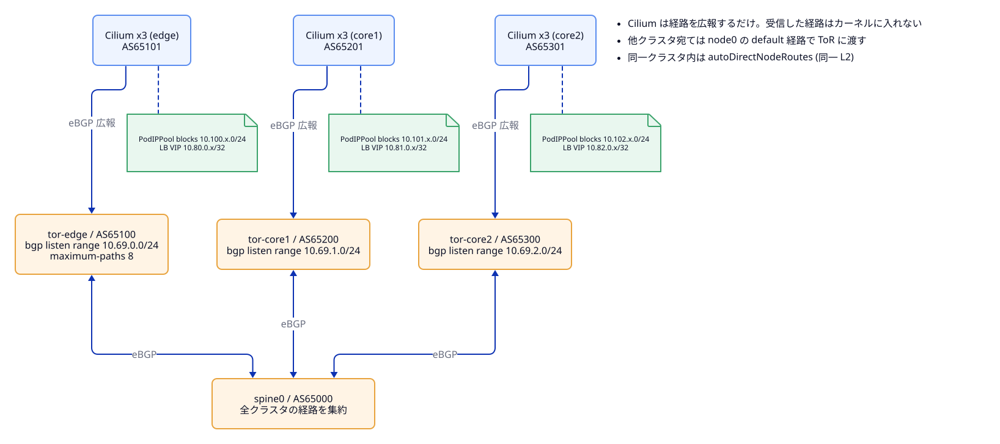
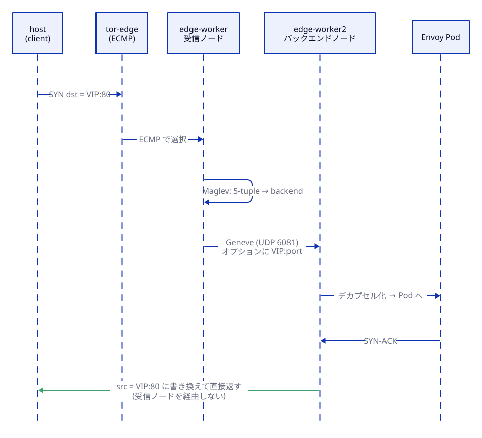

# Cilium（KPR / multi-pool IPAM / BGP / LB IPAM / DSR / Maglev）

- ステータス: `Draft`
- テストラベル: `cilium`, `bgp`, `dsr`
- 関連: [network.md](network.md)（ファブリックとアドレス計画）、[envoy-gateway.md](envoy-gateway.md)（VIP の利用者）

## 1. 概要

全クラスタ（edge、core1、core2）に Cilium を入れ、kube-proxy を置き換える。機能ごとの役割は次のとおり。

| 機能 | 役割 |
|---|---|
| kube-proxy replacement (KPR) | ClusterIP / NodePort / LoadBalancer を eBPF で処理する |
| native routing | トンネルを使わずに Pod 間を通信する。同じクラスタ内は `autoDirectNodeRoutes`、クラスタ間はファブリックで運ぶ |
| multi-pool IPAM | `CiliumPodIPPool` から Pod IP を払い出す |
| BGP Control Plane v2 | PodIPPool のブロックと LB VIP を ToR に広報する |
| LB IPAM | `type: LoadBalancer` の Service に VIP を払い出す |
| DSR (Geneve) + Maglev | 外部から VIP への通信を、受信ノードを経由せずにバックエンドから直接返す。Maglev でバックエンドを一貫して選ぶ |

---

## 2. Helm values

値ファイルは `cilium/values/common.yaml` + `cilium/values/<cluster>.yaml` に分け、`helm install -f common.yaml -f <cluster>.yaml` で重ねる。キー名は、固定したバージョンの Helm Reference [C-14] で確認する。

common.yaml:

```yaml
kubeProxyReplacement: true
routingMode: native
autoDirectNodeRoutes: true
ipv4NativeRoutingCIDR: 10.0.0.0/8   # クラスタ間の Pod 通信を SNAT しない
ipam:
  mode: multi-pool
devices: node+
nodePort:
  enabled: true
  directRoutingDevice: node+
bgpControlPlane:
  enabled: true
gatewayAPI:
  enabled: false                    # Envoy Gateway と競合させない
# --- DSR / Maglev（5 章） ---
tunnelProtocol: geneve              # DSR の dispatch 専用。ルーティングは native のまま
loadBalancer:
  mode: dsr
  dsrDispatch: geneve
  algorithm: maglev
  dsrL4Translate: backend
  acceleration: disabled
```

<cluster>.yaml（edge の例）:

```yaml
cluster:
  name: edge
  id: 1
k8sServiceHost: edge-control-plane  # docker DNS で eth0 側に解決される
k8sServicePort: 6443
```

| クラスタ | `cluster.name` | `cluster.id` | `k8sServiceHost` |
|---|---|---|---|
| edge | edge | 1 | edge-control-plane |
| core1 | core1 | 2 | core1-control-plane |
| core2 | core2 | 3 | core2-control-plane |

---

## 3. multi-pool IPAM

- 各クラスタに `default` という名前の `CiliumPodIPPool` を 1 つ置く [C-4][I-1]。
  ```yaml
  apiVersion: cilium.io/v2alpha1
  kind: CiliumPodIPPool
  metadata:
    name: default
  spec:
    ipv4:
      cidrs: [10.100.0.0/16]   # edge。core1 は 10.101.0.0/16、core2 は 10.102.0.0/16
      maskSize: 24             # ノード単位のブロックの大きさ
  ```
- マニフェストは `cilium/ipam/<cluster>.yaml` に置き、Cilium のインストール直後に適用する。
- Pod や Namespace にアノテーションがなければ `default` プールが使われる。プールの選択は Pod の作成時にだけ評価される [C-4]。
- 追加プール（拡張点）は、`ipam.cilium.io/ip-pool` アノテーションで選ぶ。CIDR は [network.md](network.md) 3.3 に従う。

---

## 4. BGP Control Plane / LB IPAM

### 4.1 方針

- 各ノードの Cilium が、自クラスタの ToR GW（.1）と eBGP で張る。ASN はクラスタごとに 1 つ（[network.md](network.md) 3.1）。
- 広報するもの:
  - `CiliumPodIPPool`: ノードに割り当てられたブロック。multi-pool では `PodCIDR` タイプではなくこちらを使う [C-10][I-1]。
  - `Service`: `LoadBalancerIP`
- LB IPAM は `CiliumLoadBalancerIPPool` で、クラスタごとのプール（edge 10.80.0.0/24、core1 10.81.0.0/24、core2 10.82.0.0/24）を払い出す [C-13]。
- リソースの構成は neco-apps-lite の `network/cilium/loadbalancer.yaml` [I-7] を雛形にする。



### 4.2 リソース（edge の例）

`apiVersion` とフィールド名は、固定した Cilium バージョンの CRD に合わせて確認する。

```yaml
apiVersion: cilium.io/v2
kind: CiliumBGPClusterConfig
metadata:
  name: tor
spec:
  bgpInstances:
  - name: tor
    localASN: 65101
    peers:
    - name: tor-edge
      peerASN: 65100
      peerAddress: 10.69.0.1
      peerConfigRef:
        name: tor
---
apiVersion: cilium.io/v2
kind: CiliumBGPPeerConfig
metadata:
  name: tor
spec:
  timers:
    holdTimeSeconds: 9
    keepAliveTimeSeconds: 3
  gracefulRestart:
    enabled: true
  families:
  - afi: ipv4
    safi: unicast
    advertisements:
      matchLabels:
        advertise: tor
---
apiVersion: cilium.io/v2
kind: CiliumBGPAdvertisement
metadata:
  name: tor
  labels:
    advertise: tor
spec:
  advertisements:
  - advertisementType: CiliumPodIPPool
    selector:
      matchExpressions:
      - { key: never-used, operator: NotIn, values: ["never"] }
  - advertisementType: Service
    service:
      addresses: [LoadBalancerIP]
    selector:
      matchExpressions:
      - { key: never-used, operator: NotIn, values: ["never"] }
---
apiVersion: cilium.io/v2
kind: CiliumLoadBalancerIPPool
metadata:
  name: default
spec:
  blocks:
  - cidr: 10.80.0.0/24
```

---

## 5. DSR (Geneve) / Maglev

### 5.1 振る舞い



- 外部から VIP 宛ての通信:
  1. ToR が ECMP で受信ノードを選ぶ。
  2. 受信ノードが Maglev でバックエンドを選び、Geneve でバックエンドノードへ転送する。
  3. 応答はバックエンドノードからクライアントへ直接返る。
- `geneve` dispatch は native routing でも使える。`opt` dispatch は native routing 専用 [C-1]。古い資料には DSR と Geneve の関係について食い違う記述がある [C-3]。
- Maglev が効くのは外部（N-S）の通信だけ [C-1]。
- Envoy Pod から core Pod への通信は Pod IP に直接向かうので、DSR は関係しない。core の LB Service に直接アクセスする通信には DSR が効く。
- `externalTrafficPolicy: Cluster` の Service で観察する。

### 5.2 Maglev の設定

- `maglev.tableSize` は既定値（16381）のままにする [C-1]。
- `maglev.hashSeed` は、全ノードで同じ値にする必要がある [C-1]。クラスタごとに固定値を values に書き、再現性を保つ。

---

## 6. 配置するファイル

```
kindcluster/mcs-gateway/cilium/
├── values/{common,edge,core1,core2}.yaml
├── ipam/{edge,core1,core2}.yaml               # CiliumPodIPPool
└── bgp/{edge,core1,core2}/                    # ClusterConfig / PeerConfig / Advertisement / LBIPPool
```

Taskfile のタスク:

- `deploy-cilium`: helm install と CiliumPodIPPool の適用。全ノードが Ready になるまで待つ。
- `deploy-bgp`: BGP と LB IPAM のリソースを適用する。
- `deploy-dsr`: DSR / Maglev を有効にした values で helm upgrade する。

---

## 7. テスト仕様

### 7.1 `cilium`

| # | 確かめること | 観測方法 | 期待値 |
|---|---|---|---|
| cilium-01 | ノードの状態 | `kubectl get nodes`（3 コンテキスト） | 全ノードが Ready |
| cilium-02 | Cilium の状態 | `cilium status --wait` | OK |
| cilium-03 | kube-proxy がいない | `kubectl -n kube-system get ds kube-proxy` | 存在しない |
| cilium-04 | Pod IP のプール | テスト用 Pod の `status.podIP` | 自クラスタのプール CIDR 内にある |
| cilium-05 | クラスタ内のノードをまたぐ Pod-to-Pod | worker の Pod から worker2 の Pod へ HTTP | 成功する |
| cilium-06 | ClusterIP（KPR） | Pod から ClusterIP Service へ HTTP | 成功する |
| cilium-07 | NodePort（KPR） | ノードの node0 IP:NodePort へ HTTP | 成功する |

### 7.2 `bgp`

| # | 確かめること | 観測方法 | 期待値 |
|---|---|---|---|
| bgp-01 | Cilium と ToR のセッション | ToR で `show bgp summary json` | 自クラスタの全ノード（3 台）が Established |
| bgp-02 | PodIPPool の経路 | spine0 で `show ip route json` | 3 クラスタ分のノードブロック（/24）がある |
| bgp-03 | LB VIP の経路 | テスト用 LB Service を作り、spine0 の経路を見る | VIP の /32 がある |
| bgp-04 | クラスタ間の Pod-to-Pod | edge の Pod から core1、core2 の Pod へ HTTP | 成功する |
| bgp-05 | SNAT されない | bgp-04 の宛先 Pod で送信元 IP を見る | edge の Pod IP のまま |
| bgp-06 | host から VIP | host から LB VIP へ HTTP | 成功する |

### 7.3 `dsr`

| # | 確かめること | 観測方法 | 期待値 |
|---|---|---|---|
| dsr-01 | Service の LB 設定 | `cilium-dbg service list` / `cilium-dbg bpf lb list` | DSR と Maglev になっている |
| dsr-02 | Geneve での転送 | 受信ノードの `node0` を tcpdump | バックエンドノード宛ての Geneve（UDP 6081）が観測される |
| dsr-03 | 応答の直接返送 | 受信ノードの `node0` を tcpdump | VIP からクライアントへの応答が受信ノードを通らない |
| dsr-04 | Maglev の一貫性 | 送信元ポートを固定し、受信ノードを変えて同じ 5-tuple で接続する | 同じバックエンドが選ばれる |
| dsr-05 | MTU | 大きなペイロード（例: 1 MB）の HTTP を VIP 経由で取得する | 欠落なく取得できる |

---

## 8. 未確定事項

- **MTU:** Geneve のカプセル化で増える分（50 byte 程度）を見込む必要がある。`node0` とファブリックの MTU を上げるか、Pod の MTU を下げるかを決める。
- **multi-pool の制約:** native routing、BPF masquerade、KPR、DSR との組み合わせの制約を、固定したバージョンのドキュメントで確認する [C-4][C-5]。
- **LB IPAM の既定:** 固定したバージョンで LB IPAM が既定で有効かを確認する [C-13]。

---

## 9. 参考文献

[I-1] [I-6] [I-7] [C-1]〜[C-18] [D-1]〜[D-3]（[references.md](references.md)）
