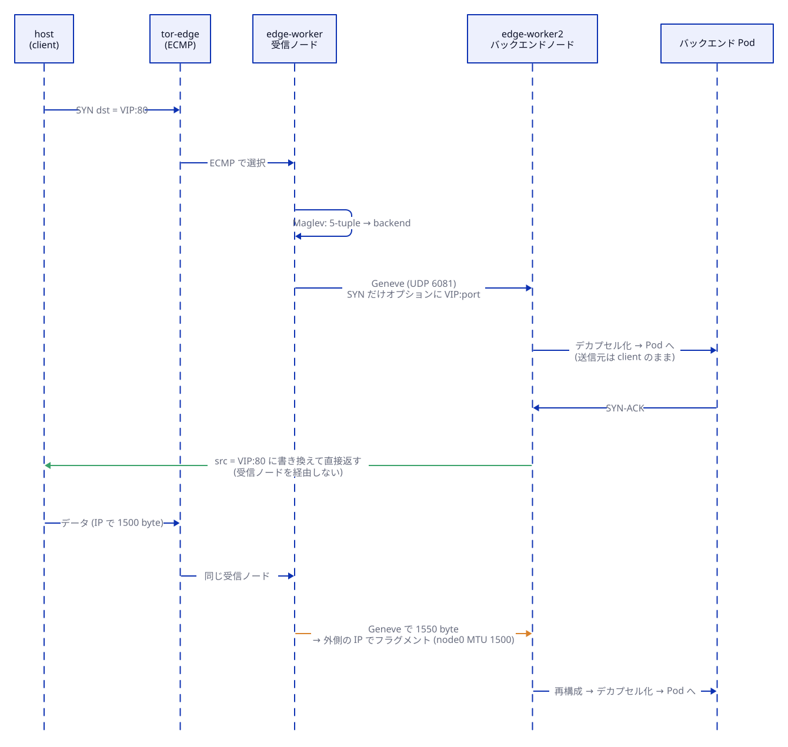

# Cilium（KPR / multi-pool IPAM / BGP / LB IPAM / DSR / Maglev）

- ステータス: `Reviewed`
- テストラベル: `cilium`, `bgp`, `dsr`
- 関連: [network.md](network.md)（ファブリックとアドレス計画）、[envoy-gateway.md](envoy-gateway.md)（VIP の利用者）

## 1. 概要

全クラスタ（edge、core1、core2）に Cilium 1.20.4 を入れ、kube-proxy を置き換える。機能ごとの役割と、入れる PR は次のとおり。

| 機能 | 役割 | PR |
|---|---|---|
| kube-proxy replacement (KPR) | ClusterIP / NodePort / LoadBalancer を eBPF で処理する | 03 |
| native routing | トンネルを使わずに Pod 間を通信する。同じクラスタ内は `autoDirectNodeRoutes`、クラスタ間はファブリックで運ぶ | 03 |
| multi-pool IPAM | `CiliumPodIPPool` から Pod IP を払い出す | 03 |
| eBPF masquerade | Pod から外への通信を node0 のアドレスに SNAT する | 03 |
| BGP Control Plane v2 | PodIPPool のブロックと LB VIP を ToR に広報する | 04 |
| LB IPAM | `type: LoadBalancer` の Service に VIP を払い出す | 04 |
| DSR (Geneve) + Maglev | 外部から VIP への通信を、受信ノードを経由せずにバックエンドから直接返す。Maglev でバックエンドを一貫して選ぶ | 05 |

PR 03 の時点では、Pod の経路はまだ ToR に広報されない（PR 04）。そのため、PR 03 で通るのはクラスタ内の通信と、SNAT される外への通信だけになる。クラスタ間の Pod 通信は PR 04 で確かめる。

---

## 2. Helm values

### 2.1 インストール

- チャートは `https://helm.cilium.io` の `cilium` 1.20.4。`helm repo add` はせず、`--repo` と `--version` で直接指定する（ユーザーの helm の repo 設定を変えないため）。
- クラスタごとに次を実行する。`upgrade --install` なので、何度実行しても同じ状態になる。
  ```sh
  helm upgrade --install cilium cilium \
    --repo https://helm.cilium.io --version 1.20.4 \
    --kube-context kind-<cluster> -n kube-system \
    -f cilium/values/common.yaml -f cilium/values/<cluster>.yaml
  ```
- `helm --wait` は付けない。Cilium agent は Pod のプールができるまで Ready にならないので、helm の待ちとプールの apply がお互いを待ってしまうため（3 章）。
- helm の後に、次の順で実行する。
  1. `kubectl wait --for condition=established crd/ciliumpodippools.cilium.io`。CRD は helm ではなく、Cilium operator が起動時に作る（v1.20.4 の `pkg/k8s/apis/cilium.io/client/register.go` [C-22]）。
  2. `kubectl apply -f cilium/ipam/<cluster>.yaml`（3 章）
  3. `cilium status --wait --context kind-<cluster>` と、全ノードの Ready を待つ。
- チャートのイメージは既定で digest 付き（`useDigest: true`）なので、values ではイメージを指定しない。
- 値ファイルは `cilium/values/common.yaml` と `cilium/values/<cluster>.yaml` に分ける。PR 04、05 で増える設定も、同じ 2 つのファイル（または PR 05 の `dsr.yaml`）に足していく。
- Kubernetes のリソース（`CiliumPodIPPool`、PR 04 以降の BGP のリソースなど）は Helm の values で作らず、マニフェストとして `cilium/` の下に置いて apply する。リポジトリのファイルが望ましい状態そのものになるようにするため。

### 2.2 common.yaml

```yaml
kubeProxyReplacement: true
routingMode: native
autoDirectNodeRoutes: true
ipv4NativeRoutingCIDR: 10.64.0.0/10  # クラスタのアドレス空間。クラスタ間の Pod 通信を SNAT しない
devices: node0
bpf:
  masquerade: true                  # multi-pool では iptables の masquerade に egressMasqueradeInterfaces が要るので、eBPF を使う [C-4]
ipam:
  mode: multi-pool
operator:
  replicas: 1
gatewayAPI:
  enabled: false                    # Envoy Gateway と競合させない
```

- **`devices: node0`**: Cilium の BPF プログラムを付けるデバイス。kind ノードの `eth0`（docker の `kind` ネットワーク）は API server に届くためだけに使うので、含めない（[network.md](network.md) 2.1）。neco-apps-lite は `node+` と書いているが、ノードの IF は `node0` だけなので名前で書く。
- **direct routing device**: 書かない。Cilium は、`devices` で選ばれたデバイスが 1 つならそれを使う（v1.20.4 の `pkg/datapath/tables/direct_routing_device.go` [C-23]）。
- **`nodePort.enabled` と `nodePort.directRoutingDevice`**: 書かない。neco-apps-lite の values にはあるが、v1.20.4 のチャートの `values.yaml` にはもうない [C-21]。NodePort は KPR を有効にすると有効になる。チャートの values のスキーマは知らないキーをエラーにしないので、書いても黙って無視される。[testing.md](testing.md) 4.1 の `lint:helm` で、この種の書き間違いを見つける。
- **`ipv4NativeRoutingCIDR: 10.64.0.0/10`**（10.64.0.0〜10.127.255.255）: クラスタのアドレス空間で、ノード（10.69.0.0/16）、LB VIP（10.80.0.0/14）、Pod（10.100〜、追加プールを含む）、Service（10.110〜10.112）がすべて入る。この範囲への通信は SNAT しない。
  - 範囲の外への通信は、node0 のアドレスに SNAT される。host（172.30.0.1）、インターネット、ファブリックの機器（10.255.0.0/16。DNS リゾルバ `dns0` を含む）が該当する。
  - `10.0.0.0/8` にしない理由: ファブリックの機器は Pod の経路を知らない（PR 03 では Pod の経路を広報しないし、`dns0` は spine にデフォルト経路を向けない）。`dns0` への問い合わせを SNAT しないと、応答が Pod に戻らない。
- **`operator.replicas: 1`**: 既定は 2。1 クラスタ 3 ノードの小さな構成なので、1 で足りる。
- **`autoDirectNodeRoutes`**: 同じクラスタのノードは同じ L2（ToR の `br0`）にいるので、各ノードが他のノードの Pod ブロックへの経路を node0 経由で持つ。multi-pool で払い出したブロックも、この経路の対象になる（v1.20.4 の `pkg/k8s/node.go` の `ParseCiliumNode` が、プールのブロックを `IPv4SecondaryAllocCIDRs` に入れる [C-24]）。
- DSR と Maglev の設定は PR 05 で足す（5 章）。PR 03 では入れない。
- BGP Control Plane（`bgpControlPlane.enabled`）は PR 04 で足す（4 章）。

### 2.3 <cluster>.yaml

edge の例:

```yaml
cluster:
  name: edge
  id: 1
k8sServiceHost: edge-control-plane  # docker DNS で eth0 側のアドレスに解決される
k8sServicePort: 6443
```

| クラスタ | `cluster.name` | `cluster.id` | `k8sServiceHost` |
|---|---|---|---|
| edge | edge | 1 | edge-control-plane |
| core1 | core1 | 2 | core1-control-plane |
| core2 | core2 | 3 | core2-control-plane |

- **`k8sServiceHost`**: Cilium agent は hostNetwork で動き、チャートの既定では `dnsPolicy` を指定しない。hostNetwork の Pod の `ClusterFirst` は、ノードの `/etc/resolv.conf`（docker の組み込み DNS）を使う。そのため、CoreDNS が動く前でもコンテナ名を引ける。Cilium の kind 用の手順 [C-15] と neco-apps-lite [I-6] も、control-plane のコンテナ名を書いている。
- `cluster.id` は ClusterMesh を使わないので必須ではないが、クラスタを見分けるために書く。

### 2.4 BPF host routing と DNS

- Cilium は、カーネルが対応していれば BPF host routing を使う（既定）。Pod からの通信は netfilter を通らない。このラボでも既定のままにする。
- kind のノードは、docker の DNS（`172.18.0.1`）への問い合わせを iptables の DNAT で docker の組み込み DNS に渡す。Pod からの通信はこの DNAT を通らないので、CoreDNS の既定の設定（`forward . /etc/resolv.conf`）では外の名前を引けない（PR 03 の実装時に確かめた）。
- `bpf.hostLegacyRouting: true` にすると Pod の通信が netfilter を通り、DNS は動く。これは採らない。
  - 問題は kind と docker の DNS の仕組みにあり、Cilium の側にはない。その回避のために、PR 05 で観察する DSR などのデータパスまで変えたくない。
  - neco-apps-lite は `hostLegacyRouting: true` にしているが、これは Coil との chaining（`cni.chainingMode: generic-veth`）のためで、DNS とは関係がない [I-6]。
- 代わりに、ファブリックに DNS リゾルバ `dns0`（10.255.0.7）を置き、クラスタの CoreDNS の上流をそこに向ける（[network.md](network.md) 2.8）。
- CoreDNS の設定は `coredns/configmap.yaml`（`kube-system/coredns` の ConfigMap。全クラスタ共通）で管理し、`deploy-coredns` で apply する。中身は kind の既定の Corefile のうち、`forward` だけを変える。
  ```
  forward . 10.255.0.7 {
     max_concurrent 1000
  }
  ```
  - `reload` プラグインに任せると、ConfigMap の変更が Pod のボリュームに届くまで 1 分以上かかり、その間は古い上流のままになる（PR 03 の実装時に、`deploy-coredns` の直後のテストがこれで失敗した）。そこで `deploy-coredns` は、`coredns/configmap.yaml` のハッシュを Deployment の Pod テンプレートの annotation（`mcsgw/corefile-sha256`）に付け、ロールアウトの完了を待つ。Corefile が変わらなければ annotation も変わらず、CoreDNS は再起動しない。
  - ConfigMap は kubeadm が作ったものなので、server-side apply（`--force-conflicts`）で上書きする。
  - PR 07 で、同じ ConfigMap に `multicluster` の設定を足す（[mcs.md](mcs.md)）。

---

## 3. multi-pool IPAM

- 各クラスタに `default` という名前の `CiliumPodIPPool` を 1 つ置く [C-4][I-1]。ノード単位のブロックは /24。
  ```yaml
  apiVersion: cilium.io/v2alpha1
  kind: CiliumPodIPPool
  metadata:
    name: default
  spec:
    ipv4:
      cidrs: [10.100.0.0/16]   # edge。core1 は 10.101.0.0/16、core2 は 10.102.0.0/16
      maskSize: 24
  ```
- マニフェストは `cilium/ipam/<cluster>.yaml` に置き、2.1 節の手順で apply する。
- Helm の `ipam.operator.autoCreateCiliumPodIPPools` では作らない。operator が起動時に 1 度作るだけで、後から values を変えてもプールは変わらない。リポジトリの内容とクラスタの状態がずれるため。
- Cilium agent は、自ノードにプールのブロックが割り当てられるまで Ready にならない [C-25]。そのため、helm install の後、Ready を待つ前にプールを apply する（2.1 節）。
- 使用中のプールの CIDR は変えられない。CIDR を足すことはできる [C-4]。
- `CiliumPodIPPool` の API は v1.20.4 でも `cilium.io/v2alpha1` のまま。
- Pod や Namespace にアノテーションがなければ `default` プールが使われる。プールの選択は Pod の作成時にだけ評価される [C-4]。
- 追加プール（拡張点）は、`ipam.cilium.io/ip-pool` アノテーションで選ぶ。CIDR は [network.md](network.md) 3.3 に従う。
- multi-pool の制約は、v1.20.4 では「プールの CIDR が重ならないこと」と「iptables の masquerade には `egressMasqueradeInterfaces` が要ること」の 2 つ [C-4]。前者はアドレス計画で、後者は `bpf.masquerade: true` で満たす。

### 3.1 Pod の通信経路（PR 03 の時点）

| 通信 | 経路 | SNAT |
|---|---|---|
| 同じノードの Pod 間 | ノード内 | しない |
| 別ノードの Pod 間（同じクラスタ） | node0 → ToR の `br0`（L2）→ 相手の node0。`autoDirectNodeRoutes` の経路 | しない |
| Pod → ClusterIP | Pod の中で socket LB がバックエンドに変換し、上と同じ経路 | しない |
| Pod → API server | `kubernetes` Service のバックエンドは control-plane の `eth0` のアドレス（172.18.0.x、[network.md](network.md) 2.2）。行きは Pod のノードの `eth0` から出る | しない（`eth0` は `devices` に含めないので、masquerade されない） |
| Pod → インターネット | node0 → ToR → spine0 → spine の NAT | node0 のアドレスに SNAT し、さらに spine で SNAT |
| CoreDNS → `dns0` | node0 → ToR → spine0 → `dns0` | node0 のアドレスに SNAT する（2.2 節） |
| host → NodePort | host → spine0 → ToR → node0 | — |

Pod → API server は、行きと帰りで別の IF を通る。API server からの応答は、宛先が Pod のアドレスなので、control-plane の `autoDirectNodeRoutes` の経路に従って `node0` から返る。Pod のノードでは、応答は `eth0` ではなく `node0` に届く。この経路で通ることを cilium-09 で確かめた。

---

## 4. BGP Control Plane / LB IPAM

### 4.1 方針

- 各ノードの Cilium が、自クラスタの ToR GW（.1）と eBGP で張る。ASN はクラスタごとに 1 つ（[network.md](network.md) 3.1）。
- 広報するもの:
  - `CiliumPodIPPool`: ノードに割り当てられたブロック。multi-pool では `PodCIDR` タイプではなくこちらを使う [C-10][I-1]。
  - `Service`: `LoadBalancerIP`
- LB IPAM は `CiliumLoadBalancerIPPool` で、クラスタごとのプール（edge 10.80.0.0/24、core1 10.81.0.0/24、core2 10.82.0.0/24）を払い出す [C-13]。
- リソースの構成は neco-apps-lite の `network/cilium/loadbalancer.yaml` [I-7] を雛形にする。


### 4.2 リソース（edge の例）

`apiVersion` とフィールド名は、固定した Cilium バージョンの CRD に合わせて確認する。

```yaml
apiVersion: cilium.io/v2
kind: CiliumBGPClusterConfig
metadata:
  name: tor
spec:
  bgpInstances:
  - name: tor
    localASN: 65101
    peers:
    - name: tor-edge
      peerASN: 65100
      peerAddress: 10.69.0.1
      peerConfigRef:
        name: tor
---
apiVersion: cilium.io/v2
kind: CiliumBGPPeerConfig
metadata:
  name: tor
spec:
  timers:
    holdTimeSeconds: 9
    keepAliveTimeSeconds: 3
  gracefulRestart:
    enabled: true
  families:
  - afi: ipv4
    safi: unicast
    advertisements:
      matchLabels:
        advertise: tor
---
apiVersion: cilium.io/v2
kind: CiliumBGPAdvertisement
metadata:
  name: tor
  labels:
    advertise: tor
spec:
  advertisements:
  - advertisementType: CiliumPodIPPool
    selector:
      matchExpressions:
      - { key: never-used, operator: NotIn, values: ["never"] }
  - advertisementType: Service
    service:
      addresses: [LoadBalancerIP]
    selector:
      matchExpressions:
      - { key: never-used, operator: NotIn, values: ["never"] }
---
apiVersion: cilium.io/v2
kind: CiliumLoadBalancerIPPool
metadata:
  name: default
spec:
  blocks:
  - cidr: 10.80.0.0/24
```

---

## 5. DSR (Geneve) / Maglev

### 5.1 振る舞い



- 外部から VIP 宛ての通信:
  1. ToR が ECMP で受信ノードを選ぶ。
  2. 受信ノードが Maglev でバックエンドを選び、Geneve でバックエンドノードへ転送する。
  3. 応答はバックエンドノードからクライアントへ直接返る。
- `geneve` dispatch は native routing でも使える。`opt` dispatch は native routing 専用 [C-1]。古い資料には DSR と Geneve の関係について食い違う記述がある [C-3]。
- Maglev が効くのは外部（N-S）の通信だけ [C-1]。
- Envoy Pod から core Pod への通信は Pod IP に直接向かうので、DSR は関係しない。core の LB Service に直接アクセスする通信には DSR が効く。
- `externalTrafficPolicy: Cluster` の Service で観察する。

### 5.2 Maglev の設定

- `maglev.tableSize` は既定値（16381）のままにする [C-1]。
- `maglev.hashSeed` は、全ノードで同じ値にする必要がある [C-1]。クラスタごとに固定値を values に書き、再現性を保つ。

---

## 6. 配置するファイル

```
kindcluster/mcs-gateway/cilium/
├── values/{common,edge,core1,core2}.yaml      # 03（04、05 で追記）
├── ipam/{edge,core1,core2}.yaml               # 03: CiliumPodIPPool
└── bgp/{edge,core1,core2}/                    # 04: ClusterConfig / PeerConfig / Advertisement / LBIPPool
kindcluster/mcs-gateway/coredns/
└── configmap.yaml                             # 03: Corefile（全クラスタ共通。07 で追記）
```

Taskfile:

| タスク | 内容 | PR |
|---|---|---|
| `deploy-cilium` | 3 クラスタに 2.1 節の手順（`helm upgrade --install`、CRD の待ち、プールの apply、`cilium status --wait`、ノードの Ready の待ち）を実行する | 03 |
| `deploy-coredns` | 3 クラスタに `coredns/configmap.yaml` を apply し、Corefile のハッシュで CoreDNS をロールアウトして完了を待つ（2.4 節） | 03 |
| `lint:helm` | 3 クラスタ分の values で `helm template` を実行する。あわせて、values のキーがチャートの既定の values にあることを確かめる（[testing.md](testing.md) 4.1） | 03 |
| `deploy-bgp` | BGP と LB IPAM のリソースを適用する | 04 |
| `deploy-dsr` | DSR / Maglev を有効にした values で helm upgrade する | 05 |

`task start` は `deploy-fabric` の後に `deploy-cilium`、`deploy-coredns` の順に実行する（[operations.md](operations.md) 4 章）。

---

## 7. テスト仕様

テスト用の Pod は次の 2 つのイメージを使う。どちらも digest 付きで固定する。

- サーバ: `registry.k8s.io/e2e-test-images/agnhost` の `netexec`。`/clientip` で、見えた送信元のアドレスを返す。版は実装時に最新を選ぶ。
- クライアント: `nicolaka/netshoot:v0.16`（sidecar と同じ。`curl` が入っている）

### 7.1 `cilium`

| # | 確かめること | 観測方法 | 期待値 |
|---|---|---|---|
| cilium-01 | ノードの状態 | `kubectl get nodes`（3 コンテキスト） | 全 9 ノードが Ready |
| cilium-02 | Cilium の状態 | `cilium status --wait --context kind-<cluster>` | 3 クラスタとも OK |
| cilium-03 | kube-proxy の置き換え | `kubectl -n kube-system get ds kube-proxy`、cilium Pod で `cilium-dbg status --output json` | kube-proxy の DaemonSet がない。`kubeProxyReplacement` が `True` |
| cilium-04 | ノードのブロック | `CiliumNode` の `spec.ipam.pools.allocated` | 全ノードに `default` プールの /24 があり、自クラスタのプールの CIDR 内にある |
| cilium-05 | Pod IP | テスト用 Pod の `status.podIP` | 自クラスタのプールの CIDR 内にある |
| cilium-06 | 別ノードの Pod 間（クラスタ内） | worker の netshoot から worker2 の agnhost の Pod IP へ `curl /clientip` | 成功し、返る送信元が netshoot の Pod IP（SNAT されない） |
| cilium-07 | ClusterIP | netshoot から agnhost の ClusterIP Service へ `curl` | 成功する |
| cilium-08 | NodePort | host から全ノードの node0 IP:NodePort へ `curl` | agnhost がいないノードを含め、すべて成功する |
| cilium-09 | Pod から API server | netshoot から `curl -sk https://kubernetes.default.svc/livez` | `ok` が返る（3.1 節の行きと帰りで IF が違う経路） |
| cilium-10 | Pod から外の名前の解決 | netshoot で `dig +short registry.k8s.io`（クラスタの CoreDNS → `dns0`） | A レコードが返る |
| cilium-11 | Pod からインターネット | netshoot から `curl https://registry.k8s.io/v2/` | HTTP の応答が返る（ステータスは問わない）。eBPF masquerade と spine の NAT を通る |

cilium-02 から cilium-11 は 3 クラスタすべてで確かめる。テスト用 Pod は `nodeName` で置くノードを決める（agnhost は worker2、netshoot は worker）。

### 7.2 `bgp`


| # | 確かめること | 観測方法 | 期待値 |
|---|---|---|---|
| bgp-01 | Cilium と ToR のセッション | ToR で `show bgp summary json` | 自クラスタの全ノード（3 台）が Established |
| bgp-02 | PodIPPool の経路 | spine0 で `show ip route json` | 3 クラスタ分のノードブロック（/24）がある |
| bgp-03 | LB VIP の経路 | テスト用 LB Service を作り、spine0 の経路を見る | VIP の /32 がある |
| bgp-04 | クラスタ間の Pod-to-Pod | edge の Pod から core1、core2 の Pod へ HTTP | 成功する |
| bgp-05 | SNAT されない | bgp-04 の宛先 Pod で送信元 IP を見る | edge の Pod IP のまま |
| bgp-06 | host から VIP | host から LB VIP へ HTTP | 成功する |

### 7.3 `dsr`

| # | 確かめること | 観測方法 | 期待値 |
|---|---|---|---|
| dsr-01 | Service の LB 設定 | `cilium-dbg service list` / `cilium-dbg bpf lb list` | DSR と Maglev になっている |
| dsr-02 | Geneve での転送 | 受信ノードの `node0` を tcpdump | バックエンドノード宛ての Geneve（UDP 6081）が観測される |
| dsr-03 | 応答の直接返送 | 受信ノードの `node0` を tcpdump | VIP からクライアントへの応答が受信ノードを通らない |
| dsr-04 | Maglev の一貫性 | 送信元ポートを固定し、受信ノードを変えて同じ 5-tuple で接続する | 同じバックエンドが選ばれる |
| dsr-05 | MTU（Geneve で運ばれる方向） | バックエンドが受信ノードと別のノードにだけいる状態で、host から VIP へ大きなリクエストボディ（例: 1 MB の POST。MSS いっぱいのセグメントになる）を送る。受信ノードの `node0` を tcpdump し、`cilium-dbg monitor --type drop` を見る | 全体が届いて 200 が返る。MSS いっぱいのセグメントも Geneve で転送され、ICMP frag-needed も drop も出ない |

---

## 8. 未確定事項

- **MTU（PR 05）:** Geneve のカプセル化で増える分（50 byte 程度）を見込む必要がある。`node0` とファブリックの MTU を上げるか、Pod の MTU を下げるかを決める。
- **DSR と multi-pool の組み合わせ（PR 05）:** v1.20.4 の multi-pool の制約には DSR は挙がっていない [C-4]。PR 05 で確かめる。
- **LB IPAM の既定（PR 04）:** 固定したバージョンで LB IPAM が既定で有効かを確認する [C-13]。

---

## 9. 参考文献

[I-1] [I-6] [I-7] [C-1]〜[C-18] [C-21]〜[C-25] [D-1]〜[D-3] [T-12]（[references.md](references.md)）
