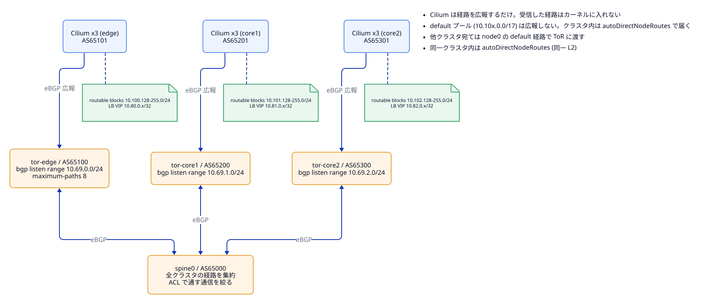

# Cilium（KPR / multi-pool IPAM / BGP / LB IPAM / DSR / Maglev）

- ステータス: `Reviewed`
- テストラベル: `cilium`, `bgp`
- 関連: [network.md](network.md)（ファブリックとアドレス計画）、[envoy-gateway.md](envoy-gateway.md)（VIP の利用者）

## 1. 概要

全クラスタ（edge、core1、core2）に Cilium 1.20.4 を入れ、kube-proxy を置き換える。機能ごとの役割と、入れる PR は次のとおり。

| 機能 | 役割 | PR |
|---|---|---|
| kube-proxy replacement (KPR) | ClusterIP / NodePort / LoadBalancer を eBPF で処理する | 03 |
| native routing | トンネルを使わずに Pod 間を通信する。同じクラスタ内は `autoDirectNodeRoutes`、クラスタ間はファブリックで運ぶ | 03 |
| multi-pool IPAM | `CiliumPodIPPool` から Pod IP を払い出す。クラスタの中だけで使う `default` と、クラスタ間で使う `routable` の 2 つのプールで、Pod がクラスタの外に出られるかを分ける | 03（`default`）、04（`routable`） |
| eBPF masquerade | Pod から外への通信を node0 のアドレスに SNAT する | 03 |
| BGP Control Plane v2 | `routable` プールのブロックと LB VIP を ToR に広報する | 04 |
| LB IPAM | `type: LoadBalancer` の Service に VIP を払い出す | 04 |
| DSR (Geneve) + Maglev | 外部から VIP への通信を、受信ノードを経由せずにバックエンドから直接返す。Maglev でバックエンドを一貫して選ぶ | 05 |

PR 03 の時点では、Pod の経路はまだ ToR に広報されない（PR 04）。そのため、PR 03 で通るのはクラスタ内の通信と、SNAT される外への通信だけになる。クラスタ間の Pod 通信は PR 04 で確かめる。

クラスタ間で通してよい通信は、プールと spine0 の ACL で決める（PR 04。3 章、[network.md](network.md) 2.9）。

- `default` プールの Pod は、クラスタの外に出るときノードのアドレスに SNAT される。広報しないので、外から直接は届かない。
- `routable` プールの Pod は SNAT されず、ブロックを広報する。edge の L7LB（Envoy）の Pod と、そのバックエンドが使う。
- spine0 の ACL が、送信元と宛先のアドレスで通信を許可する（edge の `routable` から core の `routable`、LB VIP のメッシュ、host から edge）。

---

## 2. Helm values

### 2.1 インストール

- チャートは `https://helm.cilium.io` の `cilium` 1.20.4。`helm repo add` はせず、チャートの tgz の URL で直接指定する（ユーザーの helm の repo 設定を変えないため）。`cilium --repo ...` と書くと、helm がリポジトリの `cilium/` ディレクトリをチャートとして読んでしまう。
- クラスタごとに次を実行する。`upgrade --install` なので、何度実行しても同じ状態になる。
  ```sh
  helm upgrade --install cilium https://helm.cilium.io/cilium-1.20.4.tgz \
    --kube-context kind-<cluster> -n kube-system \
    -f cilium/values/common.yaml -f cilium/values/<cluster>.yaml
  ```
- `helm --wait` は付けない。Cilium agent は Pod のプールができるまで Ready にならないので、helm の待ちとプールの apply がお互いを待ってしまうため（3 章）。
- helm の後に、次の順で実行する。
  1. `kubectl wait --for condition=established crd/ciliumpodippools.cilium.io`。CRD は helm ではなく、Cilium operator が起動時に作る（v1.20.4 の `pkg/k8s/apis/cilium.io/client/register.go` [C-22]）。
  2. `kubectl apply -f cilium/ipam/<cluster>.yaml`（3 章）
  3. `cilium status --wait --context kind-<cluster>` と、全ノードの Ready を待つ。
- チャートのイメージは既定で digest 付き（`useDigest: true`）なので、values ではイメージを指定しない。
- 値ファイルは `cilium/values/common.yaml` と `cilium/values/<cluster>.yaml` に分ける。PR 04、05 で増える設定も、同じ 2 つのファイル（または PR 05 の `dsr.yaml`）に足していく。
- Kubernetes のリソース（`CiliumPodIPPool`、PR 04 以降の BGP のリソースなど）は Helm の values で作らず、マニフェストとして `cilium/` の下に置いて apply する。リポジトリのファイルが望ましい状態そのものになるようにするため。

### 2.2 common.yaml

```yaml
kubeProxyReplacement: true
routingMode: native
autoDirectNodeRoutes: true
devices: node0
bpf:
  masquerade: true                  # multi-pool では iptables の masquerade に egressMasqueradeInterfaces が要るので、eBPF を使う [C-4]
ipam:
  mode: multi-pool
bgpControlPlane:
  enabled: true                     # 04（4 章）
rollOutCiliumPods: true             # 04: values の変更で agent を作り直す
operator:
  replicas: 1
  rollOutPods: true                 # 04: values の変更で operator を作り直す
tunnelProtocol: geneve              # 05: DSR の geneve dispatch に要る。ルーティングは native のまま
loadBalancer:
  mode: dsr                         # 05（5 章）
  dsrDispatch: geneve               # 05
  algorithm: maglev                 # 05
gatewayAPI:
  enabled: false                    # Envoy Gateway と競合させない
```

- **`devices: node0`**: Cilium の BPF プログラムを付けるデバイス。kind ノードの `eth0`（docker の `kind` ネットワーク）は API server に届くためだけに使うので、含めない（[network.md](network.md) 2.1）。neco-apps-lite は `node+` と書いているが、ノードの IF は `node0` だけなので名前で書く。
- **direct routing device**: 書かない。Cilium は、`devices` で選ばれたデバイスが 1 つならそれを使う（v1.20.4 の `pkg/datapath/tables/direct_routing_device.go` [C-23]）。
- **`nodePort.enabled` と `nodePort.directRoutingDevice`**: 書かない。neco-apps-lite の values にはあるが、v1.20.4 のチャートの `values.yaml` にはもうない [C-21]。NodePort は KPR を有効にすると有効になる。チャートの values のスキーマは知らないキーをエラーにしないので、書いても黙って無視される。[testing.md](testing.md) 4.1 の `lint:helm` で、この種の書き間違いを見つける。
- **`ipv4NativeRoutingCIDR`**: クラスタごとの値なので `<cluster>.yaml` に書く（2.3 節）。
- **`operator.replicas: 1`**: 既定は 2。1 クラスタ 3 ノードの小さな構成なので、1 で足りる。
- **`autoDirectNodeRoutes`**: 同じクラスタのノードは同じ L2（ToR の `br0`）にいるので、各ノードが他のノードの Pod ブロックへの経路を node0 経由で持つ。multi-pool で払い出したブロックも、この経路の対象になる（v1.20.4 の `pkg/k8s/node.go` の `ParseCiliumNode` が、プールのブロックを `IPv4SecondaryAllocCIDRs` に入れる [C-24]）。
- **`bgpControlPlane.enabled`**（PR 04）: BGP Control Plane を有効にする（4 章）。BGP の CRD は、これが有効なときだけ operator が作る（v1.20.4 の `pkg/k8s/synced/crd.go` [C-26]）。
- **`rollOutCiliumPods`、`operator.rollOutPods`**（PR 04）: 既定は `false`。`false` のままだと、`helm upgrade` で ConfigMap（`cilium-config`）が変わっても agent と operator は古い設定のまま動き続ける。`true` にすると、チャートが ConfigMap のハッシュを Pod テンプレートの annotation に入れるので、設定が変わったときだけ作り直される [C-21]。
  - PR 03 のラボに PR 04 の values を当てる場合や、PR 04 のラボに PR 05 の DSR の values を当てる場合のように、既存のクラスタの values を変える場面で必要になる。
  - 設定が変わらなければハッシュも変わらないので、`task start` を繰り返しても agent は再起動しない。
- **`tunnelProtocol`、`loadBalancer`**（PR 05）: DSR を Geneve dispatch で使い、バックエンドを Maglev で選ぶ（5 章）。
  - `loadBalancer.mode`、`dsrDispatch`、`algorithm` は、チャートの既定の values ではコメントアウトされているが、テンプレートは参照している（`cilium-configmap.yaml` の `bpf-lb-mode` など）。
  - そのため、`lint:helm` は、テンプレートが参照するキーも既知のキーとして扱う（[testing.md](testing.md) 4.1）。
  - `pmtuDiscovery` は既定（`false`）のままにする（5.3 節）。
- **DSR を入れるタスク:** 当初は `deploy-dsr` という別のタスクで helm upgrade する予定だったが、やめた。DSR の values は `common.yaml` に書き、`deploy-cilium` の 1 回の `helm upgrade --install` で入れる。
  - 別のタスクにすると、`task start` のたびに Cilium を 2 回 upgrade することになる。
  - PR 04 のラボに PR 05 の values を当てる場合も、`rollOutCiliumPods` で agent が作り直されるので、`deploy-cilium` だけで足りる。

### 2.3 <cluster>.yaml

edge の例:

```yaml
cluster:
  name: edge
  id: 1
k8sServiceHost: edge-control-plane  # docker DNS で eth0 側のアドレスに解決される
k8sServicePort: 6443
ipv4NativeRoutingCIDR: 10.100.0.0/16  # 自クラスタの Pod（default と routable）。この範囲への通信は SNAT しない
maglev:
  hashSeed: bWNzZ3ctZWRnZS0x           # 05: base64 で 12 byte（5.2 節）
```

| クラスタ | `cluster.name` | `cluster.id` | `k8sServiceHost` | `ipv4NativeRoutingCIDR` | `maglev.hashSeed` |
|---|---|---|---|---|---|
| edge | edge | 1 | edge-control-plane | 10.100.0.0/16 | `bWNzZ3ctZWRnZS0x`（`mcsgw-edge-1`） |
| core1 | core1 | 2 | core1-control-plane | 10.101.0.0/16 | `bWNzZ3ctY29yZTEx`（`mcsgw-core11`） |
| core2 | core2 | 3 | core2-control-plane | 10.102.0.0/16 | `bWNzZ3ctY29yZTIx`（`mcsgw-core21`） |

- **`k8sServiceHost`**: Cilium agent は hostNetwork で動き、チャートの既定では `dnsPolicy` を指定しない。hostNetwork の Pod の `ClusterFirst` は、ノードの `/etc/resolv.conf`（docker の組み込み DNS）を使う。そのため、CoreDNS が動く前でもコンテナ名を引ける。Cilium の kind 用の手順 [C-15] と neco-apps-lite [I-6] も、control-plane のコンテナ名を書いている。
- `cluster.id` は ClusterMesh を使わないので必須ではないが、クラスタを見分けるために書く。
- **`maglev.hashSeed`**（PR 05）: 12 文字の ASCII を base64 にした値。乱数である必要はなく、クラスタの中で同じであればよい（5.2 節）。
- **`ipv4NativeRoutingCIDR`**（PR 04 で `10.64.0.0/10` から変えた）: 自クラスタの Pod の /16（[network.md](network.md) 3.1）。Cilium の eBPF masquerade は、送信元を node0 のアドレスに SNAT するかを、次の順に決める（v1.20.4 の `bpf/lib/nat.h` の `snat_v4_needs_masquerade` [C-30]）。
  1. 宛先が `ipv4NativeRoutingCIDR` の中なら SNAT しない。
  2. 送信元の Pod のプールが `skip-masquerade` なら SNAT しない（3 章）。
  3. 宛先が別のノード（native routing）なら SNAT しない。
  4. それ以外は SNAT する。
  - 自クラスタの Pod 間（両方のプール）は 1. で SNAT しない。
  - `default` の Pod から、ほかのクラスタ（Pod、LB VIP）、host、インターネット、`dns0` への通信は 4. で SNAT される。応答はノードのアドレスに返るので、`default` を広報しなくても戻り道がある。CoreDNS から `dns0` への問い合わせ（2.4 節）もこれで通る。
  - `routable` の Pod からの通信は、2. で SNAT されない。送信元が Pod IP のままなので、spine0 の ACL がプールを見分けられる。
  - PR 03 の `10.64.0.0/10` は、ほかのクラスタの Pod と VIP を含んでいた。そのままだと、`default` の Pod から別クラスタの VIP への通信が SNAT されず、応答の宛先（`default` のアドレス）への経路がないので通らない。

### 2.4 BPF host routing と DNS

- Cilium は、カーネルが対応していれば BPF host routing を使う（既定）。Pod からの通信は netfilter を通らない。このラボでも既定のままにする。
- kind のノードは、docker の DNS（`172.18.0.1`）への問い合わせを iptables の DNAT で docker の組み込み DNS に渡す。Pod からの通信はこの DNAT を通らないので、CoreDNS の既定の設定（`forward . /etc/resolv.conf`）では外の名前を引けない（PR 03 の実装時に確かめた）。
- `bpf.hostLegacyRouting: true` にすると Pod の通信が netfilter を通り、DNS は動く。これは採らない。
  - 問題は kind と docker の DNS の仕組みにあり、Cilium の側にはない。その回避のために、PR 05 で観察する DSR などのデータパスまで変えたくない。
  - neco-apps-lite は `hostLegacyRouting: true` にしているが、これは Coil との chaining（`cni.chainingMode: generic-veth`）のためで、DNS とは関係がない [I-6]。
- 代わりに、ファブリックに DNS リゾルバ `dns0`（10.255.0.7）を置き、クラスタの CoreDNS の上流をそこに向ける（[network.md](network.md) 2.8）。
- CoreDNS の設定は `coredns/configmap.yaml`（`kube-system/coredns` の ConfigMap。全クラスタ共通）で管理し、`deploy-coredns` で apply する。中身は kind の既定の Corefile のうち、`forward` だけを変える。
  ```
  forward . 10.255.0.7 {
     max_concurrent 1000
  }
  ```
  - `reload` プラグインに任せると、ConfigMap の変更が Pod のボリュームに届くまで 1 分以上かかり、その間は古い上流のままになる（PR 03 の実装時に、`deploy-coredns` の直後のテストがこれで失敗した）。そこで `deploy-coredns` は、`coredns/configmap.yaml` のハッシュを Deployment の Pod テンプレートの annotation（`mcsgw/corefile-sha256`）に付け、ロールアウトの完了を待つ。Corefile が変わらなければ annotation も変わらず、CoreDNS は再起動しない。
  - ConfigMap は kubeadm が作ったものなので、server-side apply（`--force-conflicts`）で上書きする。
  - PR 07 で、同じ ConfigMap に `multicluster` の設定を足す（[mcs.md](mcs.md)）。

---

## 3. multi-pool IPAM

各クラスタに `CiliumPodIPPool` を 2 つ置く [C-4][I-1]。ノード単位のブロックはどちらも /24。アドレスは [network.md](network.md) 3.1、3.3。

| プール | 用途 | edge | core1 | core2 | SNAT | BGP で広報 | PR |
|---|---|---|---|---|---|---|---|
| `default` | クラスタの中だけで使う。指定のない Pod はすべてこちら | 10.100.0.0/17 | 10.101.0.0/17 | 10.102.0.0/17 | クラスタの外に出るとき、ノードで SNAT | しない | 03 |
| `routable` | クラスタ間で使う（edge の L7LB の Pod と、そのバックエンド） | 10.100.128.0/17 | 10.101.128.0/17 | 10.102.128.0/17 | しない（`skip-masquerade`） | する | 04 |

`cilium/ipam/edge.yaml`:

```yaml
apiVersion: cilium.io/v2alpha1
kind: CiliumPodIPPool
metadata:
  name: default
spec:
  ipv4:
    cidrs: [10.100.0.0/17]
    maskSize: 24
---
apiVersion: cilium.io/v2alpha1
kind: CiliumPodIPPool
metadata:
  name: routable
  annotations:
    ipam.cilium.io/skip-masquerade: "true"
spec:
  ipv4:
    cidrs: [10.100.128.0/17]
    maskSize: 24
  namespaceSelector:
    matchExpressions:
      - key: kubernetes.io/metadata.name
        operator: In
        values: [bgp-test, envoy-gateway-system]  # 04（bgp-test）、06（envoy-gateway-system、edge だけ）
```

- **プールの選び方:** `routable` を使う Namespace は、プールの側の `namespaceSelector` で決める（v1.20.4 の `Documentation/network/concepts/ipam/multi-pool.rst` [C-29]）。Namespace や Pod のアノテーション（`ipam.cilium.io/ip-pool`）は使わない。
  - クラスタの外に出てよい Pod の一覧が、`cilium/ipam/<cluster>.yaml` の 1 か所にまとまる。境界を 1 か所で管理するため。
  - Namespace は名前（`kubernetes.io/metadata.name` ラベル。Kubernetes が付ける）で選ぶ。ほかのコンポーネントが作る Namespace にラベルを足さなくてよい。
  - どのプールの selector にも合わない Pod は `default` から払い出される [C-29]。`namespaceSelector` に書き忘れた Namespace の Pod は、黙って `default` になる。Envoy とバックエンドの書き忘れは、PR 08 の multicluster-gateway のテストが通らないことで分かる（spine0 の ACL で拒否される）。
  - PR 04 ではテスト用の `bgp-test` だけを書く。edge の `envoy-gateway-system`（Envoy のデータプレーンとコントローラ。[envoy-gateway.md](envoy-gateway.md) 2.3）は PR 06 で、core の `demo`（バックエンド。[mcs.md](mcs.md)）は PR 07 で足す。
- **`skip-masquerade`:** `routable` の Pod の送信元を、ノードで SNAT しない（v1.20.4 の `pkg/ipam/multipool.go` の `shouldSkipMasqForPool` [C-31]）。native routing でも効くことを、PR 04 の実装時に bgp-04 で確かめた（アノテーションの定義のコメントには「tunneling mode のとき」とあるが、`bpf/lib/nat.h` の判定にその条件はない [C-30]）。ドキュメントも、BGP で広報するプールの Pod の送信元を保ち、ネットワーク側のファイアウォールでほかのプールと見分けるために使う、としている [C-29]。インターネットへの通信は spine で SNAT する（[network.md](network.md) 2.3）。
- プールの選択と `skip-masquerade` は、Pod の作成時にだけ評価される [C-29]。後から変えても、動いている Pod には効かない。
- プールのブロックは、そのプールの Pod が置かれたノードにだけ払い出される。`routable` のブロックを持つのは、`routable` の Pod がいるノードだけになる（PR 04 の実装時に確かめた）。
- マニフェストは `cilium/ipam/<cluster>.yaml` に置き、2.1 節の手順で apply する。
- Helm の `ipam.operator.autoCreateCiliumPodIPPools` では作らない。operator が起動時に 1 度作るだけで、後から values を変えてもプールは変わらない。リポジトリの内容とクラスタの状態がずれるため。
- Cilium agent は、自ノードにプールのブロックが割り当てられるまで Ready にならない [C-25]。そのため、helm install の後、Ready を待つ前にプールを apply する（2.1 節）。
- 使用中のプールの CIDR は変えられない。CIDR を足すことはできる [C-4]。PR 03 の `default`（/16）を /17 にするには、ラボを作り直す。
- `CiliumPodIPPool` の API は v1.20.4 でも `cilium.io/v2alpha1` のまま。
- multi-pool の制約は、v1.20.4 では「プールの CIDR が重ならないこと」と「iptables の masquerade には `egressMasqueradeInterfaces` が要ること」の 2 つ [C-4]。前者はアドレス計画で、後者は `bpf.masquerade: true` で満たす。

### 3.1 Pod の通信経路（PR 03 の時点）

| 通信 | 経路 | SNAT |
|---|---|---|
| 同じノードの Pod 間 | ノード内 | しない |
| 別ノードの Pod 間（同じクラスタ） | node0 → ToR の `br0`（L2）→ 相手の node0。`autoDirectNodeRoutes` の経路 | しない |
| Pod → ClusterIP | Pod の中で socket LB がバックエンドに変換し、上と同じ経路 | しない |
| Pod → API server | `kubernetes` Service のバックエンドは control-plane の `eth0` のアドレス（172.18.0.x、[network.md](network.md) 2.2）。行きは Pod のノードの `eth0` から出る | しない（`eth0` は `devices` に含めないので、masquerade されない） |
| Pod → インターネット | node0 → ToR → spine0 → spine の NAT | `default`: node0 のアドレスに SNAT し、さらに spine で SNAT。`routable`（04）: spine でだけ SNAT |
| CoreDNS → `dns0` | node0 → ToR → spine0 → `dns0` | node0 のアドレスに SNAT する（2.3 節） |
| host → NodePort | host → spine0 → ToR → node0 | — |

Pod → API server は、行きと帰りで別の IF を通る。API server からの応答は、宛先が Pod のアドレスなので、control-plane の `autoDirectNodeRoutes` の経路に従って `node0` から返る。Pod のノードでは、応答は `eth0` ではなく `node0` に届く。この経路で通ることを cilium-09 で確かめた。

---

## 4. BGP Control Plane / LB IPAM

### 4.1 方針

- 各ノードの Cilium が、自クラスタの ToR の GW（.1）と eBGP で張る。ASN はクラスタごとに 1 つ（[network.md](network.md) 3.1）。
  - ToR は `bgp listen range` の動的ネイバーで受けるので、セッションは Cilium の側から張る。ToR の FRR の設定は PR 02 のまま変えない（[network.md](network.md) 2.3）。
  - Cilium の BGP は経路を広報するだけで、受け取った経路はカーネルに入れない。他クラスタ宛ての通信は、ノードのデフォルト経路（node0 → ToR）で運ぶ（[network.md](network.md) 2.4）。
- 広報するもの:
  - **`CiliumPodIPPool`**: `routable` プールのうち、自ノードに割り当てられたブロック（/24）。multi-pool では `PodCIDR` タイプではなくこちらを使う [C-10][I-1]。v1.20.4 の実装は、`CiliumNode` の `spec.ipam.pools.allocated` のうち、広報の selector に合うプールのブロックだけを広報する（`pkg/bgp/manager/reconciler/pod_ip_pool.go` [C-27]）。
    - selector では、Cilium がプールに付けるラベル `io.cilium.podippool.name` で `routable` を選ぶ [C-27]。プールに独自のラベルを足さなくてよい。
    - `default` のブロックは広報しない。クラスタ内のノード間は `autoDirectNodeRoutes` で届く（2.2 節）。
  - **`Service`** の `LoadBalancerIP`: LB VIP の /32。`externalTrafficPolicy: Cluster` の Service は全ノードが広報するので、ToR は 3 ノードへの ECMP にする（`maximum-paths 8`）。
- LB IPAM は既定で有効（v1.20.4 のチャートの `enableLBIPAM: true`、`defaultLBServiceIPAM: lbipam` [C-21]）。`CiliumLoadBalancerIPPool` で、クラスタごとのプール（edge 10.80.0.0/24、core1 10.81.0.0/24、core2 10.82.0.0/24）から払い出す [C-13]。
- リソースの構成は neco-apps-lite の `network/cilium/loadbalancer.yaml` [I-7] を雛形にする。



### 4.2 リソース

API はすべて `cilium.io/v2`（v1.20.4 の CRD [C-28]）。クラスタごとに違うのは ASN、ToR のアドレス、LB のプールだけなので、共通の部分と分ける。

`cilium/bgp/common.yaml`（全クラスタ共通）:

```yaml
apiVersion: cilium.io/v2
kind: CiliumBGPPeerConfig
metadata:
  name: tor
spec:
  timers:
    connectRetryTimeSeconds: 5    # 既定 120。セッションが落ちたときの張り直しを待たない
    holdTimeSeconds: 9            # FRR の datacenter の既定にそろえる
    keepAliveTimeSeconds: 3
  gracefulRestart:
    enabled: true
  families:
    - afi: ipv4
      safi: unicast
      advertisements:
        matchLabels:
          advertise: tor
---
apiVersion: cilium.io/v2
kind: CiliumBGPAdvertisement
metadata:
  name: tor
  labels:
    advertise: tor
spec:
  advertisements:
    - advertisementType: CiliumPodIPPool
      selector:                   # selector がないと何も選ばない。routable だけを選ぶ
        matchLabels:
          io.cilium.podippool.name: routable
    - advertisementType: Service
      service:
        addresses: [LoadBalancerIP]
      selector:                   # 全 Service を選ぶ
        matchExpressions:
          - {key: never-used, operator: NotIn, values: ["never"]}
```

`cilium/bgp/edge.yaml`:

```yaml
apiVersion: cilium.io/v2
kind: CiliumBGPClusterConfig
metadata:
  name: tor
spec:
  bgpInstances:
    - name: tor
      localASN: 65101
      peers:
        - name: tor-edge
          peerASN: 65100
          peerAddress: 10.69.0.1
          peerConfigRef:
            name: tor
```

`cilium/lbipam/edge.yaml`:

```yaml
apiVersion: cilium.io/v2
kind: CiliumLoadBalancerIPPool
metadata:
  name: default
spec:
  blocks:
    - cidr: 10.80.0.0/24
```

| クラスタ | `localASN` | `peerASN` | `peerAddress` | LB のプール |
|---|---|---|---|---|
| edge | 65101 | 65100 | 10.69.0.1 | 10.80.0.0/24 |
| core1 | 65201 | 65200 | 10.69.1.1 | 10.81.0.0/24 |
| core2 | 65301 | 65300 | 10.69.2.1 | 10.82.0.0/24 |

- **`nodeSelector`**: 書かない。control-plane を含む全ノードが張る。kind の control-plane も Pod を持ち（Cilium、CoreDNS など）、そのブロックを広報する必要があるため。
- **`peerAddress`**: 明示する。v1.20.4 には、ノードのデフォルト経路の GW をピアにする `autoDiscovery`（`DefaultGateway`）もある [C-28]。ただし ASN はクラスタごとに書く必要があり、ファイルを共通にできない。ToR の `bgp listen range` と対で読めるよう、アドレスを書く。
- **router-id**: 書かない。既定（`bgpControlPlane.routerIDAllocation.mode: default`）では、ノードの IPv4 アドレスから決まる [C-21]。ノードのアドレスは全クラスタで重ならない。
- **timers**: FRR は `frr defaults datacenter` で keepalive 3 秒、hold 9 秒。Cilium の既定（30 秒、90 秒）のままでも、OPEN で小さい方に合うが、両側の設定を読んで同じ値になるようにそろえる。
- **graceful restart**: neco-apps-lite と同じく有効にする。FRR は既定で helper として動く [F-1]。agent の再起動（`rollOutCiliumPods`）のあいだ、ToR が経路を保つ。

### 4.3 適用の手順（`deploy-bgp`）

クラスタごとに次を実行する。

1. BGP の CRD（`ciliumbgpclusterconfigs`、`ciliumbgppeerconfigs`、`ciliumbgpadvertisements`）と `ciliumloadbalancerippools` が established になるのを待つ。operator が起動時に作るので、`deploy-cilium` の直後にはまだないことがある（2.1 節）。
2. `kubectl apply -f cilium/bgp/common.yaml -f cilium/bgp/<cluster>.yaml -f cilium/lbipam/<cluster>.yaml`

セッションの確立と経路の収束は待たない。テストは `EventuallyWithT` で待つ（[testing.md](testing.md)）。

### 4.4 通信経路（PR 04 の時点）

3.1 節の表に、次が加わる。

| 通信 | 経路 | SNAT |
|---|---|---|
| edge の `routable` → core の `routable` | node0 → 自クラスタの ToR → spine0（ACL で許可）→ 相手の ToR → 相手の node0。ToR と spine は Cilium が広報したブロックの経路を持つ | しない（`skip-masquerade`） |
| `default` → 別クラスタの Pod | 送信元のノードで SNAT され、spine0 の ACL で拒否される（送信元がノード、宛先が Pod） | 送信元のノードで SNAT |
| Pod → 別クラスタの LB VIP | node0 → ToR → spine0（ACL で許可）→ 相手の ToR（ECMP）→ 受信ノード。受信ノードが KPR でバックエンドを選び、別ノードなら SNAT して転送する（PR 05 で DSR に変える） | `default`: 送信元のノードで SNAT。`routable`: しない。どちらも、受信ノードとバックエンドが別なら受信ノードで SNAT |
| host → edge の LB VIP | host → spine0（ACL で許可）→ tor-edge（ECMP）→ 受信ノード。以降は上と同じ | 受信ノードとバックエンドが別なら、受信ノードで SNAT する |
| host → core | spine0 の ACL で拒否される | — |

---

## 5. DSR (Geneve) / Maglev

### 5.1 振る舞い


- ノードの外から VIP（と NodePort）に来る通信は、次の順に流れる。
  1. ToR が ECMP で受信ノードを選ぶ。
  2. 受信ノードが Maglev でバックエンドを選ぶ。
  3. バックエンドが別のノードなら、受信ノードは元のパケットを Geneve で包んでそのノードへ送る。最初の SYN だけ、Geneve のオプションに VIP とポートを入れる [C-1]。
  4. バックエンドのノードは Geneve を外して Pod に渡す。応答は送信元を VIP:port に書き換え、受信ノードを通らずにクライアントへ直接返す。
- **DSR が効く通信**
  - host から edge の VIP への通信。
  - 別のクラスタの Pod から VIP への通信。VIP を持つクラスタから見ると、ノードの外から来る通信になる。
  - spine0 から NodePort への通信（cilium-08）。
- **DSR が効かない通信**
  - 同じクラスタの Pod から VIP への通信。socket LB が `connect()` の時点でバックエンドに変換するので、VIP のパケットは流れない。
  - Envoy の Pod から core の Pod IP への通信（PR 08）。Service を通らないので、DSR は関係しない。
- **クライアントの IP が残る:** SNAT モードでは、受信ノードがバックエンドへ送るときに送信元を自分のアドレスに SNAT する。DSR では SNAT しないので、バックエンドにはクライアントの IP がそのまま見える [C-1]。
  - 別クラスタの Pod から VIP へ送ったとき、バックエンドに見える送信元は次のようになる。
    - `default` の Pod から送ったとき: 送信元のノードのアドレス（送信元のノードの SNAT は残る）。
    - `routable` の Pod から送ったとき: Pod IP。
- **観察する Service:** `externalTrafficPolicy: Cluster` の Service で観察する。`Local` にすると、バックエンドのいないノードは VIP を受けなくなり、受信ノードとバックエンドが分かれない。
- **`geneve` dispatch を使う理由:** `geneve` dispatch は native routing でも使える [C-1]。
  - 古い資料には、DSR と Geneve の関係について食い違う記述がある [C-3]。
  - `opt` dispatch（IP オプション）は、オプション付きのパケットを遅い経路で処理するルーターがあるので使わない [C-1]。

**v1.20.4 のソースで確かめたこと**

- **トンネルの設定:** DSR の `geneve` dispatch を有効にすると、`routingMode: native` のままでも `cilium_geneve` デバイスが作られる（`pkg/loadbalancer/config.go` の `tunnel.NewEnabler` [C-32]）。
  - その際、`tunnelProtocol` が `geneve` でなければ、agent の起動時に失敗する（`pkg/kpr/initializer/kube_proxy_replacement.go` [C-33]）。
  - チャートの `tunnelProtocol` の既定は空で、ConfigMap には `vxlan` が入る。そのため、`tunnelProtocol: geneve` を明示する。
- **Geneve で包む場所:** BPF はトンネルのキーを設定して、`cilium_geneve` にリダイレクトするだけ（`bpf/lib/overloadable_skb.h` の `ctx_set_encap_info4` [C-34]）。外側のヘッダを付けるのは、カーネルの geneve ドライバ。
  - キーのフラグは `BPF_F_ZERO_CSUM_TX` だけで、`BPF_F_DONT_FRAGMENT` は付けない。
  - `cilium_geneve` も df を設定せずに作る（`pkg/datapath/loader/netlink.go` [C-35]）。
  - つまり、外側の IP ヘッダには DF が立たない（5.3 節）。
- **増えるバイト数:** 外側の IP（20）、UDP（8）、Geneve（8）、内側の Ethernet（14）で 50 byte。SYN はさらに DSR のオプションの 12 byte が足される（`pkg/mtu/mtu.go` の `TunnelOverheadIPv4`、`DsrTunnelOverhead` [C-36]、`bpf/lib/nodeport.h` の `encap_geneve_dsr_opt4` [C-37]）。

### 5.2 Maglev の設定

- `maglev.tableSize` は既定値（16381）のままにする [C-1]。
- `maglev.hashSeed` は、同じクラスタの全ノードで同じ値にする必要がある [C-1]。
  - クラスタごとに固定の値を values に書き、再現性を保つ（2.3 節）。
  - 値は、base64 で 12 byte になるもの（16 文字）にする。それ以外だと agent が起動しない（`pkg/maglev/maglev.go` [C-38]）。
- Maglev を使っても、受信ノードが変わったときに同じ 5-tuple で同じバックエンドが選ばれるのは、全ノードが同じテーブルを持つから。

### 5.3 MTU

ファブリックの MTU は 1500 のままにし、`pmtuDiscovery` も有効にしない（どちらも既定のまま）。その結果、包んで MTU を超えるパケットは、外側の IP でフラグメントされて届く。まずこの状態で動作と性能を確かめ（5.4 節）、その結果を見て次の手を決める（8 章）。

- **フラグメントが起きる流れ**
  - クライアントが MSS いっぱいのセグメント（IP で 1500 byte）を送る。受信ノードが包むと 1550 byte になり、`node0`（MTU 1500）から出られない。
  - 外側に DF が立たないので（5.1 節）、受信ノードのカーネルは外側の IP パケットをフラグメントする。
  - バックエンドのノードは、IP で再構成してから Geneve を外す。内側のパケットの DF（TCP は立てる）は、外側のフラグメントには関係しない。
  - Geneve が流れるのは同じクラスタのノード間だけで、ToR の `br0` の同じ L2 の中に閉じる。フラグメントは spine を通らないので、ACL（[network.md](network.md) 2.9）にも当たらない。
- **フラグメントで起きる問題**
  - パケット数が倍になる。
  - 受け手で再構成のコストがかかる。
  - 再構成のバッファが溢れると、断片の 1 つが落ちて全体が失われる。
- **`pmtuDiscovery.enabled: true` にした場合（今回は採らない）**
  - Cilium の BPF が包む前に大きさを確かめ、超えるパケットを捨てて、クライアントに ICMP frag-needed（MTU は `node0` の MTU から増える分を引いた値）を返す。
  - 判定は `dsr_is_too_big` で、`ENABLE_DSR_ICMP_ERRORS` のときだけ働く（`bpf/lib/nodeport.h` [C-37]、`pkg/datapath/linux/config/config.go` [C-39]）。
  - フラグメントはなくなる。その代わり、クライアントと宛先の組ごとに、最初の大きなパケットが捨てられて再送になる。
- **クラスタ内の L2 の MTU を上げる場合（今回は採らない）**
  - `node0`、ToR の `br0`、ノードと ToR を結ぶリンクを 9000 などにし、Pod の MTU は values の `MTU: 1500` で固定する。
  - フラグメントも ICMP も起きなくなる。5.4 節の結果を見て検討する（8 章）。

### 5.4 性能の測定

フラグメントの影響を、Geneve を通る場合と通らない場合で比べた。PR 05 の実装時に一度だけ手で測り、結果をこの節に残す。合否のある検査ではないので、Taskfile のタスクにも `task test` にもしない。

- **構成**
  - Namespace `dsr-bench`（`default` プール）を作る。
  - edge-worker2 に、netshoot で `iperf3 -s` を動かす Pod を置く。
  - その Pod を指す `type: LoadBalancer` の Service（port 5201、`externalTrafficPolicy: Cluster`）を作る。
  - クライアントは host（`host-mcsgw` の netshoot で `iperf3 -c <VIP>`）。
- **受信ノードの固定:** 5.5 節の方法で固定する。
- **測るケース**

| # | 受信ノード | 向き | MSS | Geneve | フラグメント |
|---|---|---|---|---|---|
| 1 | edge-worker2（バックエンドと同じ） | host → Pod | 既定（1460） | なし | なし |
| 2 | edge-worker | host → Pod | 既定（1460） | あり | あり |
| 3 | edge-worker | host → Pod | 1400（`-M 1400`） | あり | なし |
| 4 | edge-worker | Pod → host（`-R`） | 既定（1460） | ACK だけ | なし |

- **ケースの意図**
  - 1 と 3 の差が、Geneve で包む分のコスト。
  - 2 と 3 の差が、フラグメントのコスト。
  - 4 は、応答を直接返す向きの確認。データを運ぶ応答は Geneve を通らない。
- **測る値**
  - 各ケースを 10 秒ずつ 3 回測り、中央値をとる。
  - `iperf3 -J` からスループットと再送の数をとる。
  - 受信ノードの `nstat` の `IpFragCreates` の増分と、バックエンドのノードの `IpReasmOKs`、`IpReasmFails` の増分も記録する。sidecar はノードと netns を共有するので、sidecar で `nstat` を実行すれば、ノードの値が読める。
- **注意:** すべてのクラスタが 1 台の host の上で動くので、値は CPU で決まる。絶対値ではなく、ケースどうしの比で見る。表には測った host の CPU とカーネルも書く。

結果:

- **測定環境**
  - host: Intel Xeon Silver 4314（16 CPU）、カーネル 7.0.0-22-generic
  - 測り方: 各ケース 10 秒 × 3 回の中央値
  - 同じ日に 2 回測った。スループットの差は 2 回で 0.05 Gbit/s 以内だった。
  - 下の表は 2 回目の値。

| # | スループット | 再送 | `IpFragCreates` | `IpReasmOKs` / `IpReasmFails` |
|---|---|---|---|---|
| 1 | 2.39 Gbit/s | 0 | 0 | 0 / 0 |
| 2 | 0.73 Gbit/s | 202 | 1,248,296 | 624,148 / 0 |
| 3 | 1.01 Gbit/s | 1,153 | 0 | 0 / 0 |
| 4 | 2.62 Gbit/s | 0 | 0 | 0 / 0 |

- **Geneve で包むコスト（1 と 3）:** スループットは 2.39 から 1.01 Gbit/s へ、約 4 割に下がる。
- **フラグメントのコスト（2 と 3）:**
  - スループットは 1.01 から 0.73 Gbit/s へ、さらに約 3 割下がる。
  - `IpFragCreates` は `IpReasmOKs` のちょうど 2 倍。つまり、Geneve で包んだパケットはどれも 2 つに分かれ、すべて再構成されている（`IpReasmFails` は 0）。
- **応答の向き（4）:** Pod から host への向きは、受信ノードを経由しない。値は 1 と同じ水準で、DSR の応答は Geneve のコストを受けない。
- **再送について**
  - 3 の再送は多いが、実際に失われたパケットはない。確認したことは次のとおり。
    - edge-worker、edge-worker2、tor-edge のインターフェースの drop が増えていない。
    - 両ノードの `IpInDiscards` と `IpOutDiscards` も増えていない。
    - Cilium の `cilium-dbg bpf metrics list` に drop が増えていない。
  - 送信側の host の `nstat` では、`TcpExtTCPDSACKRecvSegs` が `TcpRetransSegs` と同じ数だった。
    - 再送したセグメントはすべて、受信側から DSACK（すでに受け取っている）として返っている。
    - つまり、順序の入れ替わりで起きた spurious な fast retransmit である。
  - 2 は `TcpExtTCPSACKReorder` が大きく（5 秒で約 8,700）、TCP が入れ替わりに慣れるので、spurious な再送は 3 より少ない。
  - 1 と 4 は、1 回目の測定では 95 と 98 だった。
- **結論:** 1 台の host の上では、フラグメントを許しても通信は成り立つ（ケース 2 の `IpReasmFails` は 0）。コストは、Geneve で包む分の約 3 割増しである。MTU を合わせるかどうかは、この値を見て後の PR で決める（8 章）。

### 5.5 受信ノードの固定

ToR の ECMP は 3 ノードのどれかを選ぶ。DSR の動きを確かめるには、受信ノードとバックエンドのノードを分ける必要があるので、測定（5.4 節）では tor-edge に policy routing を一時的に入れて、受信ノードを決める。

```sh
# tor-edge の中で実行する（docker exec clab-mcsgw-tor-edge ...）
ip route replace <VIP>/32 via <受信ノードの node0 のアドレス> table 100
ip rule add from 172.30.0.1 to <VIP>/32 ipproto tcp [sport <port>] lookup 100 priority 100
```

- 対象は、host（`172.30.0.1`）から VIP への通信だけ。ほかの通信と、BGP の経路（main テーブル）には影響しない。
- 送信元ポートを指定すると、その 5-tuple の通信だけを固定できる。
- 片付けるときは `ip rule del` と `ip route flush table 100` を実行する。
- 応答は main テーブルで返るので、バックエンドのノードから ToR を通って host に戻る。

---

## 6. 配置するファイル

```
kindcluster/mcs-gateway/cilium/
├── values/{common,edge,core1,core2}.yaml      # 03（04、05 で追記）
├── ipam/{edge,core1,core2}.yaml               # 03: CiliumPodIPPool（default）。04 で routable を足す
├── bgp/common.yaml                            # 04: CiliumBGPPeerConfig / CiliumBGPAdvertisement
├── bgp/{edge,core1,core2}.yaml                # 04: CiliumBGPClusterConfig
└── lbipam/{edge,core1,core2}.yaml             # 04: CiliumLoadBalancerIPPool
kindcluster/mcs-gateway/coredns/
└── configmap.yaml                             # 03: Corefile（全クラスタ共通。07 で追記）
```

Taskfile:

| タスク | 内容 | PR |
|---|---|---|
| `deploy-cilium` | 3 クラスタに 2.1 節の手順（`helm upgrade --install`、CRD の待ち、プールの apply、`cilium status --wait`、ノードの Ready の待ち）を実行する | 03 |
| `deploy-coredns` | 3 クラスタに `coredns/configmap.yaml` を apply し、Corefile のハッシュで CoreDNS をロールアウトして完了を待つ（2.4 節） | 03 |
| `lint:helm` | 3 クラスタ分の values で `helm template` を実行する。あわせて、values のキーが、チャートの既定の values にあるか、テンプレートから参照されていることを確かめる（[testing.md](testing.md) 4.1） | 03（05 でテンプレートの参照を追加） |
| `deploy-bgp` | 3 クラスタに 4.3 節の手順（CRD の待ち、BGP と LB IPAM のリソースの apply）を実行する | 04 |

`task start` は `deploy-fabric` の後に `deploy-cilium`、`deploy-coredns`、`deploy-bgp` の順に実行する（[operations.md](operations.md) 4 章）。

---

## 7. テスト仕様

テスト用の Pod は次の 2 つのイメージを使う。どちらも digest 付きで固定する。

- サーバ: `registry.k8s.io/e2e-test-images/agnhost` の `netexec`。`/clientip` で、見えた送信元のアドレスを返す。版は実装時に最新を選ぶ。
- クライアント: `nicolaka/netshoot:v0.16`（sidecar と同じ。`curl` が入っている）

### 7.1 `cilium`

| # | 確かめること | 観測方法 | 期待値 |
|---|---|---|---|
| cilium-01 | ノードの状態 | `kubectl get nodes`（3 コンテキスト） | 全 9 ノードが Ready |
| cilium-02 | Cilium の状態 | `cilium status --wait --context kind-<cluster>` | 3 クラスタとも OK |
| cilium-03 | kube-proxy の置き換え | `kubectl -n kube-system get ds kube-proxy`、cilium Pod で `cilium-dbg status --output json` | kube-proxy の DaemonSet がない。`kubeProxyReplacement` が `True` |
| cilium-04 | ノードのブロック | `CiliumNode` の `spec.ipam.pools.allocated` | 全ノードに `default` プールの /24 があり、自クラスタの `default` の CIDR（/17）内にある |
| cilium-05 | Pod IP | テスト用 Pod の `status.podIP` | 自クラスタの `default` の CIDR（/17）内にある |
| cilium-06 | 別ノードの Pod 間（クラスタ内） | worker の netshoot から worker2 の agnhost の Pod IP へ `curl /clientip` | 成功し、返る送信元が netshoot の Pod IP（SNAT されない） |
| cilium-07 | ClusterIP | netshoot から agnhost の ClusterIP Service へ `curl` | 成功する |
| cilium-08 | NodePort | `nat-spine0` から全ノードの node0 IP:NodePort へ `curl` | agnhost がいないノードを含め、すべて成功する（PR 04 で、送る場所を host から spine0 に変えた。host から core には届かないため。[network.md](network.md) 2.9） |
| cilium-09 | Pod から API server | netshoot から `curl -sk https://kubernetes.default.svc/livez` | `ok` が返る（3.1 節の行きと帰りで IF が違う経路） |
| cilium-10 | Pod から外の名前の解決 | netshoot で `dig +short registry.k8s.io`（クラスタの CoreDNS → `dns0`） | A レコードが返る |
| cilium-11 | Pod からインターネット | netshoot から `curl https://registry.k8s.io/v2/` | HTTP の応答が返る（ステータスは問わない）。eBPF masquerade と spine の NAT を通る |

cilium-02 から cilium-11 は 3 クラスタすべてで確かめる。テスト用 Pod は `nodeName` で置くノードを決める（agnhost は worker2、netshoot は worker）。

### 7.2 `bgp`

テスト用のリソースは、各クラスタに次のものを作る。agnhost は worker2、netshoot は worker に置く（7.1 節と同じ）。

| Namespace | プール | 中身 |
|---|---|---|
| `bgp-test` | `routable`（`namespaceSelector` で選ばれる） | agnhost、netshoot、agnhost の `type: LoadBalancer` の Service（`externalTrafficPolicy: Cluster`） |
| `bgp-default` | `default` | netshoot |

- 期待値は、テストの中でクラスタから読む（ブロックは `CiliumNode`、VIP は Service の `status.loadBalancer.ingress`、ノードのアドレスは [network.md](network.md) 3 章）。
- `deploy-bgp` は経路の収束を待たない。
  - そのため、共通の準備処理で、全ルーター（spine0 と 3 台の ToR）が全クラスタの `routable` のブロックと VIP の経路を持つまで待つ。
  - これで、通信のテスト（bgp-04〜08）も `task test ID=...` で単独で流せる（[testing.md](testing.md) 3.6）。
  - 経路を見るテスト（bgp-01〜03、bgp-09）も、それぞれ `EventuallyWithT` で待つ。
- 「拒否される」は、次の 2 つの両方で確かめる（[network.md](network.md) 2.9）。
  - spine0 の REJECT（ICMP admin prohibited）で、`curl` がタイムアウトを待たずに失敗する（終了コード 7）。
  - spine0 の REJECT ルールのパケットカウンタ（`iptables-save -c`）が、`curl` の前後で増える。終了コード 7 は、相手のポートが閉じているときにも返るため。

| # | 確かめること | 観測方法 | 期待値 |
|---|---|---|---|
| bgp-01 | Cilium と ToR のセッション | ToR で `show bgp summary json` の `ipv4Unicast.peers` | 自クラスタの全ノード（3 台）の node0 のアドレスが Established。ピアはちょうど 3 つ |
| bgp-02 | ブロックの経路 | `CiliumNode` の `spec.ipam.pools.allocated` と、ToR、spine0 の `show ip route <ブロック> json` | 払い出された `routable` の各ブロック（Pod のいるノードだけ。3 章）を、ToR はそのノードの node0 のアドレス経由で、spine0 はそのクラスタの ToR 経由で持つ。`default` のブロックは ToR にも spine0 にもない |
| bgp-03 | LB VIP の払い出しと経路 | テスト用 Service の `status.loadBalancer.ingress`、ToR と spine0 の `show ip route <VIP>/32 json` | VIP が自クラスタの LB のプール内にある。ToR は 3 ノードへの ECMP で、spine0 は自クラスタの ToR 経由で持つ |
| bgp-04 | edge の `routable` → core の `routable` | edge の `bgp-test` の netshoot から、core1、core2 の agnhost の Pod IP へ `curl /clientip` | 成功し、返る送信元が netshoot の Pod IP（SNAT されない） |
| bgp-05 | `routable` どうしで通さないもの | core1 の netshoot から edge と core2 の agnhost へ、core2 の netshoot から edge と core1 の agnhost へ、Pod IP で `curl` | すべて拒否される |
| bgp-06 | `default` から別クラスタの Pod | edge の `bgp-default` の netshoot から、core1 の agnhost の Pod IP へ `curl` | 拒否される（送信元のノードで SNAT され、spine0 の ACL に当たる） |
| bgp-07 | L4LB のメッシュ | 各クラスタの `bgp-test` と `bgp-default` の netshoot から、ほかの 2 クラスタの VIP へ `curl /clientip` | 12 通りすべて成功する |
| bgp-08 | host から VIP | host から 3 クラスタの VIP へ `curl` | edge の VIP は成功する。core1、core2 の VIP は拒否される |
| bgp-09 | VIP の取り下げ | テスト用とは別の LB の Service を作り、経路を確かめてから消す | 消した後、ToR と spine0 から VIP の /32 がなくなる |
| bgp-10 | `routable` の Pod からインターネット | edge の `bgp-test` の netshoot から `curl https://registry.k8s.io/v2/` | HTTP の応答が返る（spine で SNAT される。[network.md](network.md) 2.3） |

bgp-04 は、`skip-masquerade` が native routing でも効くこと（3 章）の確認を兼ねる。

### 7.3 DSR

PR 05 では、DSR 専用のテスト（ラベル）は置かない。DSR を有効にした後も VIP に届くこと（疎通）は、既存のテストで確かめる。

- bgp-07（Pod から別クラスタの VIP）と bgp-08（host から edge の VIP）。受信ノードは ECMP で選ばれるので、バックエンドのいないノードに着いた通信は、Geneve でバックエンドのノードへ運ばれる。
- cilium-08（NodePort）も DSR になる。期待値（すべて成功する）は変わらない。
- 性能は 5.4 節で測る（合否のない測定）。

---

## 8. 未確定事項

- **MTU（5.3 節）:** PR 05 は、フラグメントを許したまま動かす。5.4 節の測定の結果を見て、クラスタ内の L2 の MTU を上げるかを決める。
- **DSR と multi-pool の組み合わせ（PR 05）:** v1.20.4 の multi-pool の制約には DSR は挙がっていない [C-4]。バックエンドが `routable` のプールの Pod の場合は bgp-07、bgp-08（VIP の Service は `bgp-test` の agnhost）で、`default` のプールの Pod の場合は cilium-08（NodePort も DSR になる）で、疎通を確かめる。

---

## 9. 参考文献

[I-1] [I-6] [I-7] [C-1]〜[C-18] [C-21]〜[C-39] [D-1]〜[D-3] [T-12]（[references.md](references.md)）
