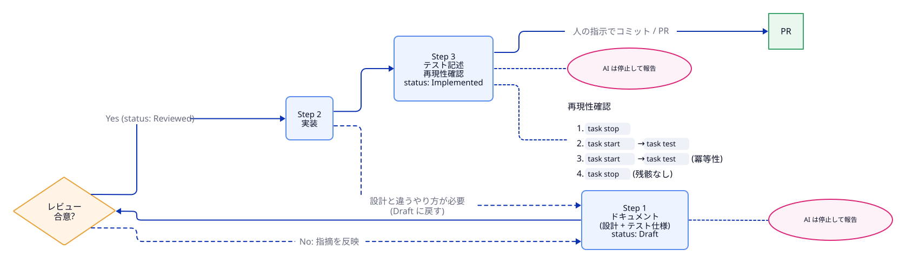
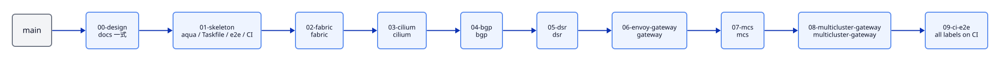

# 開発の進め方

- 関連: [README.md](README.md)、[testing.md](testing.md)、[operations.md](operations.md)

## 1. 原則

- **作業はすべて `kindcluster/mcs-gateway/` の中で行う。** ドキュメントは `docs/` に置く。CI のワークフローだけは、リポジトリの `.github/workflows/kindcluster-mcs-gateway.yml` に置く。
- **ドキュメントは、コンポーネントごとの正式なドキュメントとして書く。** PR やフェーズごとの使い捨てのメモにはしない。各ドキュメントは、常に実装の現状を正しく表すものとして保守する。
- **設計 → レビュー → 実装 → テストの順を守る。**

---

## 2. 開発プロセス

各 PR は、**必ず次の 3 ステップの順で進める。** 順序を飛ばしたり入れ替えたりしない。



### Step 1: ドキュメントを書いてレビューする

- その PR が扱うコンポーネントのドキュメント（[network.md](network.md)、[cilium.md](cilium.md)、[envoy-gateway.md](envoy-gateway.md)、[mcs.md](mcs.md) など）を書く、または更新する。
- 各コンポーネントのドキュメントは、次の節を持つ。
  1. **概要**: 何をするコンポーネントか。どの Goal に関わるか。
  2. **設計**: 構成要素、設定値、図。採らなかった案があれば、その理由。
  3. **配置するファイル** と Taskfile のタスク
  4. **テスト仕様**: テスト ID、確かめること、観測方法、期待値の表。この表がその PR の完了条件になる。
  5. **未確定事項**: このドキュメントの時点で決まっていないこと。解決したら結論を「設計」に反映し、ここから消す。
  6. **参考文献**: [references.md](references.md) の ID。読んで確かめたことは本文に書く。
- ドキュメントのステータスを `Draft` にする。
- レビューで合意したらステータスを `Reviewed` にする。それまで実装に入らない。
- 他のドキュメント（アドレス計画、命名など）に影響がある場合は、それらも同じ PR で更新する。

### Step 2: 実装する

- `Reviewed` のドキュメントのとおりに実装する。
- 実装中に、ドキュメントと違うやり方が必要になったら止まる。ドキュメントを直して `Draft` に戻し、もう一度レビューを受ける。黙ってドキュメントから外れない。

### Step 3: テストを書いて再現可能にする

- Step 1 のテスト仕様の各行を、Ginkgo の spec として実装する（[testing.md](testing.md)）。
- **再現性の確認**: クリーンな状態から次の手順を通し、すべて green になることを確認する。
  ```
  task stop
  task start
  task test
  task start
  task test
  task stop
  ```
  2 回目の `task start` と `task test` で冪等性を、最後の `task stop` で残骸が残らないことを確かめる。
- 既存のテストも含めてすべて green であること（回帰がないこと）。
- `task lint` と CI が green であること。
- ドキュメントのステータスを `Implemented` にする。ドキュメントと実装が一致していることを、最後にもう一度確かめる。
- PR 説明には、関連ドキュメントへのリンクと、再現性確認のログを貼る。

---

## 3. stacked PR 計画

### 3.1 運用

- 各 PR は 1 つ前の PR のブランチを base にする。ブランチ名は `mcsgw/NN-<topic>`。
- 下から順にマージし、マージしたら上の PR を rebase する。
- 各 PR は、2 章の 3 ステップをすべて含む。テストのない PR は作らない（00 と 01 を除く）。

### 3.2 PR 一覧



| # | ブランチ | 内容 | 主に書くドキュメント | テストラベル |
|---|---|---|---|---|
| 00 | `mcsgw/00-design` | ドキュメント一式（本書を含む） | すべて（`Draft`） | — |
| 01 | `mcsgw/01-skeleton` | aqua.yaml、Taskfile の骨組み（`setup`、`check-host`、`lint`、`test`）、e2e の suite とヘルパー、CI、バージョン固定 | [operations.md](operations.md)、[testing.md](testing.md) | —（CI の静的テストと `ginkgo --dry-run` が green であること） |
| 02 | `mcsgw/02-fabric` | containerlab、kind 3 クラスタ（CNI なし）、FRR、sidecar、host 経路 | [network.md](network.md) | `fabric` |
| 03 | `mcsgw/03-cilium` | Cilium（KPR、native routing、multi-pool IPAM） | [cilium.md](cilium.md) 1〜3 章 | `cilium` |
| 04 | `mcsgw/04-bgp` | BGP Control Plane、LB IPAM | [cilium.md](cilium.md) 4 章 | `bgp` |
| 05 | `mcsgw/05-dsr` | DSR (Geneve)、Maglev、MTU | [cilium.md](cilium.md) 5 章 | `dsr` |
| 06 | `mcsgw/06-envoy-gateway` | Envoy Gateway、edge 内の HTTPRoute | [envoy-gateway.md](envoy-gateway.md) | `gateway` |
| 07 | `mcsgw/07-mcs` | mcs-api、CoreDNS、sync.sh、サンプル | [mcs.md](mcs.md) | `mcs` |
| 08 | `mcsgw/08-multicluster-gateway` | ServiceImport を backend にする HTTPRoute | [envoy-gateway.md](envoy-gateway.md) | `multicluster-gateway` |
| 09 | `mcsgw/09-ci-e2e` | CI で E2E を実行できるかの評価と導入 | [testing.md](testing.md) 5 章 | 全ラベル（CI 上） |

### 3.3 将来の拡張候補（スコープ外）

- syncer のコントローラ化
- 障害試験: ノードの restart（neco-apps-lite の `restart-node` パターン [I-5]）、ToR の障害
- 追加の CiliumPodIPPool による Namespace 別プール

---

## 4. 命名規約（契約）

PR をまたいで名前がぶれないように、ここで固定する。変えるときはドキュメントの変更として扱う。コンポーネント固有の名前（IF 名など）は各ドキュメントに書く。

| 対象 | 名前 |
|---|---|
| ラボのディレクトリ | `kindcluster/mcs-gateway/` |
| containerlab の lab 名 | `mcsgw`（コンテナ名は `clab-mcsgw-<node>`） |
| kind クラスタ名 | `edge`, `core1`, `core2` |
| kube context | `kind-edge`, `kind-core1`, `kind-core2` |
| host の IF | `to-mcsgw` |
| Ginkgo のラベル | `fabric`, `cilium`, `bgp`, `dsr`, `gateway`, `mcs`, `multicluster-gateway` |
| テスト ID | `<ラベル>-NN`（例: `fabric-01`、`multicluster-gateway-02`） |
| Namespace | Cilium: `kube-system`、Envoy Gateway: `envoy-gateway-system`、MCS: `mcs-system`、サンプル: `demo` |
| サンプル app | `demo/echo`（port 8080）。応答にクラスタ名とノード名を含める |
| ブランチ | `mcsgw/NN-<topic>` |
| CI ワークフロー | `.github/workflows/kindcluster-mcs-gateway.yml` |

---

## 5. ディレクトリ構成

```
kindcluster/mcs-gateway/
├── docs/                          # 本書を含むドキュメント
│   ├── README.md
│   ├── network.md
│   ├── cilium.md
│   ├── envoy-gateway.md
│   ├── mcs.md
│   ├── operations.md
│   ├── testing.md
│   ├── development.md
│   ├── references.md
│   ├── diagrams/                  # 図のソース (*.d2)
│   └── images/                    # 生成した SVG (*.svg)
├── Taskfile.yaml
├── aqua.yaml
├── topology.clab.yaml
├── kind/
├── frr/
├── cilium/
├── envoy-gateway/
├── mcs/
├── sample/
└── e2e/
```

---

## 6. AI に実装させるときのルール

- 1 つの PR の中で、次の 2 か所で止まって人に報告する。
  1. Step 1 でドキュメントを書き終えたところ。レビューと合意を待つ。
  2. Step 3 の再現性確認がすべて green になったところ。差分とテストログを報告する。
- コミット、push、PR 作成は、PR ごとに人が指示したときだけ行う（リポジトリの CLAUDE.md の方針に従う）。
- 次の PR に進むのも、人の指示を受けてから。
- 実行してよい操作と、してはいけない操作は [operations.md](operations.md) 6 章に従う。
- 未確定事項に当たったら、調べた結果をドキュメントに書いてから進める。調べてもわからない、または設計を変える必要がある場合は、止まって人に聞く。

---

## 7. 図

- 図は [D2](https://d2lang.com/) で書く [T-7]。ソースは `docs/diagrams/<name>.d2`、生成物は `docs/images/<name>.svg` に置き、ドキュメントからは SVG を参照する。
- ソースと生成物の両方をコミットする。GitHub 上で生成物をそのまま表示するため。
- 生成は `task docs` で行う。中身は次のコマンドで、全図で同じオプションを使う。
  ```sh
  d2 --layout elk --theme 0 --dark-theme 200 --pad 24 docs/diagrams/<name>.d2 docs/images/<name>.svg
  ```
  `--dark-theme` を付けるので、GitHub のダークモードでも読める。
- d2 はマシン全体で使うツールとして、yatate（tomei の `cliTools`）で管理する。バージョンは [operations.md](operations.md) 2 章の表に従う。ラボの aqua.yaml には入れない。
  - CI（GitHub Actions）には yatate がないので、ワークフローで d2 の公式リリースを同じバージョンで取得する。yatate のバージョンを上げたら、ワークフローのバージョンと SVG もあわせて更新する。
- 図を変えたら、ソースと SVG を同じコミットに入れる。CI は `task docs` を再実行し、生成物に差分がないことを確かめる（[testing.md](testing.md) 4 章）。
- 図は ASCII アートで書かない。表や箇条書きで足りるものは図にしない。
- 図の内容（アドレス、ASN、名前）は本文の表と一致させる。本文を変えたら図も直す。

| 図 | 使っているドキュメント |
|---|---|
| `overview` | [README.md](README.md) |
| `request-flow` | [README.md](README.md)、[envoy-gateway.md](envoy-gateway.md) |
| `fabric` | [network.md](network.md) |
| `node-netns` | [network.md](network.md) |
| `bgp` | [network.md](network.md)、[cilium.md](cilium.md) |
| `dsr` | [cilium.md](cilium.md) |
| `mcs-sync` | [mcs.md](mcs.md) |
| `dev-process` | 本書 |
| `stacked-pr` | 本書 |
