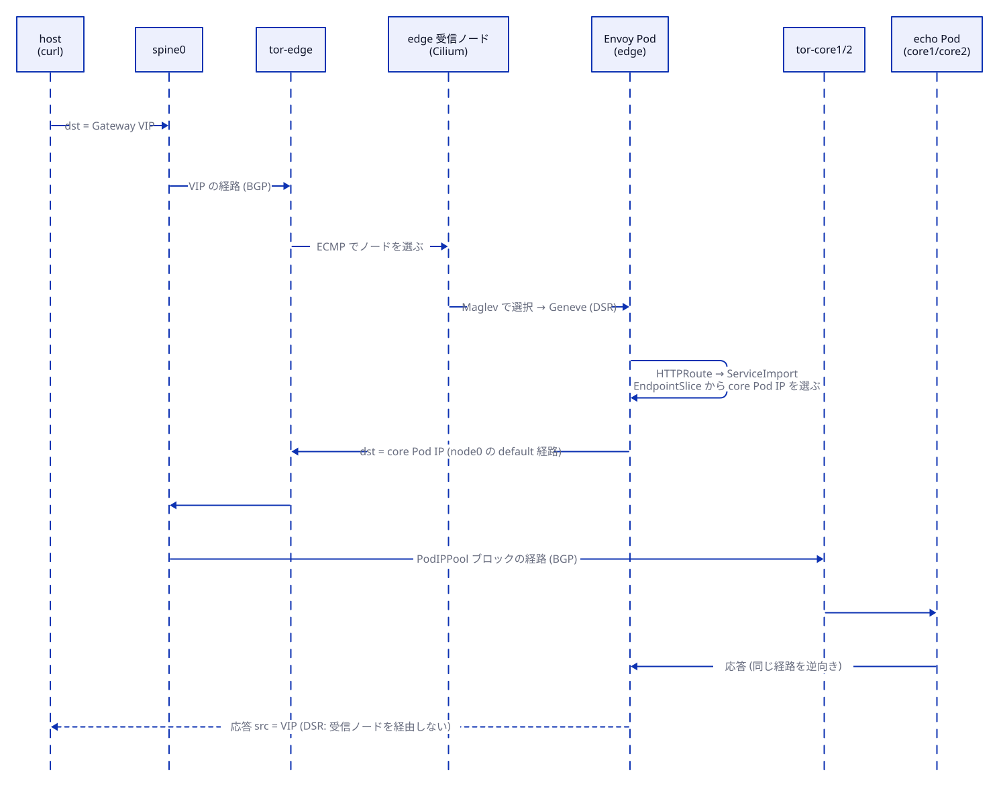

# Envoy Gateway（edge）

- ステータス: `Draft`
- テストラベル: `gateway`, `multicluster-gateway`
- 関連: [cilium.md](cilium.md)（VIP の払い出しと広報）、[mcs.md](mcs.md)（ServiceImport の提供元）

## 1. 概要

edge クラスタだけに Envoy Gateway を入れて、L7LB として動かす。

- 外部（host）からは Cilium LB IPAM が払い出した VIP で受ける。
- backend は 2 段階で広げる。
  - 同じクラスタの Service（`gateway`）
  - MCS の `ServiceImport` を経由した core クラスタの Pod（`multicluster-gateway`）

---

## 2. 設計

### 2.1 構成要素

| リソース | 名前 | 備考 |
|---|---|---|
| Gateway API CRD | standard channel | Envoy Gateway が要求するバージョン [E-6] |
| Envoy Gateway | helm、Namespace `envoy-gateway-system` | [E-1] |
| EnvoyProxy | `envoy-gateway-system/lb` | Envoy の Service を `type: LoadBalancer`、`externalTrafficPolicy: Cluster` にする [E-5] |
| GatewayClass | `envoy-gateway` | `parametersRef` で上記の EnvoyProxy を指す |
| Gateway | `demo/gw` | HTTP :80 |
| HTTPRoute（edge 内） | `demo/echo-local` | backend は edge の `demo/echo` Service |
| HTTPRoute（マルチクラスタ） | `demo/echo` | backend は `ServiceImport demo/echo` |

### 2.2 VIP

- Envoy の Service は `type: LoadBalancer` にする。Cilium LB IPAM が edge のプール（10.80.0.0/24）から VIP を払い出し、BGP で広報する（[cilium.md](cilium.md) 4 章）。
- `externalTrafficPolicy: Cluster` にして、DSR と Maglev の効果を観察できるようにする。
- Cilium 内蔵の Gateway API は無効にする（`gatewayAPI.enabled: false`）[C-18]。

### 2.3 ServiceImport を backend にする

```yaml
apiVersion: gateway.networking.k8s.io/v1
kind: HTTPRoute
metadata:
  name: echo
  namespace: demo
spec:
  parentRefs:
  - name: gw
  hostnames: ["echo.mcs.example"]
  rules:
  - backendRefs:
    - group: multicluster.x-k8s.io
      kind: ServiceImport
      name: echo
      port: 8080
```

- Envoy Gateway は ServiceImport を backendRef として扱える [E-3][E-4][G-3]。
- Envoy Gateway は、`multicluster.kubernetes.io/service-name` ラベル付きの EndpointSlice から core の Pod IP を解決すると想定している。実際の解決方法は Envoy Gateway のソース [E-7] で確認する（7 章）。
- ServiceImport を HTTPRoute と同じ `demo` Namespace に置き、ReferenceGrant を不要にする。公式例は Namespace をまたぐので、ReferenceGrant を使っている [E-4][G-4]。
- Envoy Gateway の公式手順は Submariner を前提にしている [E-3]。Submariner を使わない本構成は、公式手順から外れる。
- データパス: Envoy Pod → node0 → tor-edge → spine0 → tor-core → core Pod。トンネルは使わない（[network.md](network.md) 2.4）。



---

## 3. 配置するファイル

```
kindcluster/mcs-gateway/envoy-gateway/
├── values.yaml
├── envoyproxy.yaml
├── gatewayclass.yaml
├── gateway.yaml
├── echo-local.yaml                   # edge 内の echo と HTTPRoute
└── httproute-multicluster.yaml
```

Taskfile のタスク: `deploy-gateway`

---

## 4. テスト仕様

### 4.1 `gateway`

| # | 確かめること | 観測方法 | 期待値 |
|---|---|---|---|
| gateway-01 | Gateway の状態 | `kubectl get gateway demo/gw` の conditions | `Programmed=True`、アドレスが 10.80.0.0/24 内 |
| gateway-02 | VIP の経路 | spine0 の `show ip route json` | Gateway の VIP がある |
| gateway-03 | host から edge 内 backend | host から `curl -H 'Host: echo-local.mcs.example' http://<VIP>/` | 200 が返り、応答のクラスタ名が `edge` |

### 4.2 `multicluster-gateway`

| # | 確かめること | 観測方法 | 期待値 |
|---|---|---|---|
| multicluster-gateway-01 | Route の状態 | `kubectl get httproute demo/echo` の conditions | `Accepted=True`、`ResolvedRefs=True` |
| multicluster-gateway-02 | 両クラスタへの分散 | host から `Host: echo.mcs.example` で N 回（例: 50 回）リクエストする | 応答のクラスタ名に `core1` と `core2` の両方が含まれる |
| multicluster-gateway-03 | 片方のクラスタが消えたとき | core1 の echo を 0 レプリカにし、`task sync-mcs` を実行してから N 回リクエストする | すべて `core2` から返る |
| multicluster-gateway-04 | 復旧 | core1 の echo を元のレプリカ数に戻し、`task sync-mcs` を実行する | multicluster-gateway-02 が再び成り立つ |

---

## 5. 未確定事項

- Envoy Gateway が ServiceImport の endpoint をどう解決するか（EndpointSlice のラベル、必要な RBAC）を、固定したバージョンのソース [E-7] で確認する。
- EnvoyProxy で Service の type と externalTrafficPolicy を指定するフィールド名 [E-5]。

---

## 6. 参考文献

[E-1]〜[E-7] [G-1]〜[G-4] [C-18]（[references.md](references.md)）
