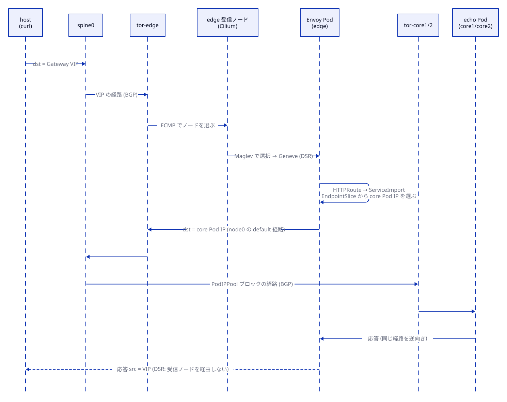

# Envoy Gateway（edge）

- ステータス: `Reviewed`
- テストラベル: `gateway`, `multicluster-gateway`
- 関連: [cilium.md](cilium.md)（VIP の払い出しと広報）、[mcs.md](mcs.md)（ServiceImport の提供元、サンプル app）

## 1. 概要

edge クラスタだけに Envoy Gateway を入れて、L7LB として動かす。

- 外部（host）からは Cilium LB IPAM が払い出した VIP で受ける。
- backend は 2 段階で広げる。
  - 同じクラスタの Service（PR 06、`gateway`）
  - MCS の `ServiceImport` を経由した core クラスタの Pod（PR 08、`multicluster-gateway`）

---

## 2. 設計

### 2.1 構成要素

| リソース | 名前 | 備考 | PR |
|---|---|---|---|
| Gateway API の CRD | experimental channel v1.6.1 | Envoy Gateway のチャートに同梱されたもの（2.2 節） | 06 |
| Envoy Gateway | helm、リリース名 `eg`、Namespace `envoy-gateway-system` | チャートは `oci://docker.io/envoyproxy/gateway-helm` の v1.9.3 [E-1]。values は既定のまま | 06 |
| EnvoyProxy | `envoy-gateway-system/lb` | Envoy の Service を `externalTrafficPolicy: Cluster` にする（2.3 節） | 06 |
| GatewayClass | `envoy-gateway` | `parametersRef` で上記の EnvoyProxy を指す | 06 |
| Gateway | `demo/gw` | HTTP :80 | 06 |
| HTTPRoute（edge 内） | `demo/echo-local` | hostname `echo-local.mcs.example`、backend は edge の Service `demo/echo` | 06 |
| サンプル app | `demo/echo` | 2.4 節。PR 06 で edge に置き、PR 07 で core にも置く（[mcs.md](mcs.md)） | 06 |
| HTTPRoute（マルチクラスタ） | `demo/echo` | backend は `ServiceImport demo/echo`（2.5 節） | 08 |

### 2.2 インストール

- `deploy-gateway` は edge にだけ、次の順に実行する。
  1. `helm upgrade --install eg oci://docker.io/envoyproxy/gateway-helm --version v1.9.3 -n envoy-gateway-system --create-namespace --wait`
  2. `envoy-gateway/` のマニフェスト（EnvoyProxy、GatewayClass、Gateway、HTTPRoute）を apply する。
  3. Gateway `demo/gw` の `Programmed` が `True` になるのを待つ。
- `--wait` で、コントローラの Deployment が Ready になってから apply する。EnvoyProxy などの CRD は、チャートの `crds/` から helm がインストール時に入れる。
- Gateway API の CRD はチャートの `charts/crds/crds/gatewayapi-crds.yaml` に同梱されている。v1.9.3 のチャートが同梱するのは **experimental channel**（`gateway.networking.k8s.io/channel: experimental`、bundle-version v1.6.1）で、standard channel ではない [E-9]。
  - experimental channel は standard channel のリソースをすべて含む。このラボが使う Gateway、GatewayClass、HTTPRoute は standard のフィールドだけで書く。
  - 単独で CRD を入れると、Envoy Gateway が要求する版や channel と食い違うおそれがある。チャートの同梱に任せる（[operations.md](operations.md) 2.1）。
- helm は `crds/` の CRD をインストール時にだけ入れ、`helm upgrade` では更新しない。版を固定しているので、このラボでは問題にならない。
- Cilium 内蔵の Gateway API は無効にしたまま（`gatewayAPI.enabled: false`）[C-18]。
- チャートの values は変えない。そのため values のファイルは置かず、`lint:helm` の対象にもしない。

### 2.3 VIP と Envoy の Pod

- Envoy の Service は、EnvoyProxy の既定の `type: LoadBalancer` のままにする。Cilium LB IPAM が edge のプール（10.80.0.0/24）から VIP を払い出し、BGP で広報する（[cilium.md](cilium.md) 4 章）。
- `externalTrafficPolicy` は EnvoyProxy の `spec.provider.kubernetes.envoyService.externalTrafficPolicy` で指定する。既定値は `Local` なので、`Cluster` を明示する [E-10]。
  - `Local` のままだと、Envoy の Pod がいないノードは VIP を受けなくなる。ToR の ECMP で選ばれたどのノードからでも Envoy に届くように、`Cluster` にする。受信ノードと Envoy の Pod が別のノードなら、DSR で転送される（[cilium.md](cilium.md) 5 章）。
- Envoy のデータプレーンの Pod は、既定の deploy mode（`ControllerNamespace`）で、コントローラと同じ `envoy-gateway-system` に作られる [E-11]。
- `envoy-gateway-system` の Pod は、edge の `routable` プールから払い出す。PR 08 で、Envoy から core のバックエンドに Pod IP で直接つなぐため（spine0 の ACL が許可するのは、edge の `routable` から core の `routable` への通信だけ。[network.md](network.md) 2.9）。
  - PR 06 で、edge の `routable` プールの `namespaceSelector` に `envoy-gateway-system` を足す（[cilium.md](cilium.md) 3 章）。
  - コントローラの Pod も同じ Namespace なので、`routable` から払い出される。外に出る通信はないので、影響はない。
  - プールは Pod の作成時にだけ選ばれる。`deploy-cilium`（プールの apply）は `deploy-gateway` より前に実行する（[operations.md](operations.md) 4 章）。
  - PR 06 では edge の中の通信だけなので、`routable` かどうかでテストの結果は変わらない。書き忘れは、PR 08 の multicluster-gateway のテストが通らないことで分かる。

### 2.4 サンプル app（echo）

- PR 06 で、edge 内の HTTPRoute の backend として `demo/echo` を置く。PR 07 で、同じマニフェストを core1、core2 にも置く（[mcs.md](mcs.md)）。
- マニフェストは `sample/echo.yaml`（Namespace `demo`、Deployment、Service）。全クラスタで共通にする。
- イメージは、テストですでに使っている agnhost（digest 付きで固定）の `porter` にする。新しいイメージを増やさないため。
  - `porter` は、環境変数 `SERVE_PORT_<port>` の値を、そのポートへのリクエストにパスを問わず返す [E-12]。
  - downward API で `NODE_NAME`（`spec.nodeName`）を入れ、`SERVE_PORT_8080` を `node=$(NODE_NAME)` にする。Kubernetes が env の中の `$(VAR)` を展開するので、応答は `node=edge-worker2` のようになる。
  - ノード名はクラスタ名で始まる（`edge-`、`core1-`、`core2-`）。応答からクラスタ名とノード名の両方が分かるので、マニフェストをクラスタごとに変えなくてよい。
- Service `demo/echo` は port 8080。レプリカは 2 にする。
- edge の `demo` は `routable` の selector に入れない。Envoy から echo への通信はクラスタの中だけなので、`default` で足りる。

### 2.5 ServiceImport を backend にする（PR 08）

```yaml
apiVersion: gateway.networking.k8s.io/v1
kind: HTTPRoute
metadata:
  name: echo
  namespace: demo
spec:
  parentRefs:
  - name: gw
  hostnames: ["echo.mcs.example"]
  rules:
  - backendRefs:
    - group: multicluster.x-k8s.io
      kind: ServiceImport
      name: echo
      port: 8080
```

- Envoy Gateway は ServiceImport を backendRef として扱える [E-3][E-4][G-3]。
- Envoy Gateway は、`multicluster.kubernetes.io/service-name` ラベル付きの EndpointSlice から core の Pod IP を解決すると想定している。実際の解決方法は Envoy Gateway のソース [E-7] で確認する（5 章）。
- ServiceImport を HTTPRoute と同じ `demo` Namespace に置き、ReferenceGrant を不要にする。公式例は Namespace をまたぐので、ReferenceGrant を使っている [E-4][G-4]。
- Envoy Gateway の公式手順は Submariner を前提にしている [E-3]。Submariner を使わない本構成は、公式手順から外れる。
- データパス: Envoy Pod → node0 → tor-edge → spine0 → tor-core → core Pod。トンネルは使わない（[network.md](network.md) 2.4）。



---

## 3. 配置するファイル

```
kindcluster/mcs-gateway/envoy-gateway/
├── envoyproxy.yaml                   # 06: EnvoyProxy lb
├── gatewayclass.yaml                 # 06: GatewayClass envoy-gateway
├── gateway.yaml                      # 06: Gateway demo/gw
├── httproute-local.yaml              # 06: HTTPRoute demo/echo-local
└── httproute-multicluster.yaml       # 08: HTTPRoute demo/echo
kindcluster/mcs-gateway/sample/
└── echo.yaml                         # 06: Namespace demo、Deployment、Service（全クラスタ共通。07 で core にも置く）
```

Taskfile:

| タスク | 内容 | PR |
|---|---|---|
| `deploy-sample` | `sample/echo.yaml` を apply し、Deployment の完了を待つ。PR 06 では edge だけ。PR 07 で core1、core2 と ServiceExport を足す | 06 |
| `deploy-gateway` | 2.2 節の手順 | 06 |
| `lint:kubeconform` | 対象に `envoy-gateway/` と `sample/` を足す。Gateway API と EnvoyProxy の CRD のスキーマは、固定した版のチャートの CRD から作る（[testing.md](testing.md) 4.1） | 06 |

`task start` では `deploy-bgp` の後に `deploy-sample`、`deploy-gateway` の順に実行する（[operations.md](operations.md) 4 章）。

---

## 4. テスト仕様

テストは疎通だけを確かめる。

### 4.1 `gateway`

| # | 確かめること | 観測方法 | 期待値 |
|---|---|---|---|
| gateway-01 | host から edge 内の backend | host から `curl -H 'Host: echo-local.mcs.example' http://<Gateway の VIP>/` | 200 が返り、本文が `node=edge-` で始まる |

- Gateway の VIP は `status.addresses` から読む。setup で Gateway の `Programmed` を待ち、VIP の /32 が spine0 に載るまで待つ。

### 4.2 `multicluster-gateway`

| # | 確かめること | 観測方法 | 期待値 |
|---|---|---|---|
| multicluster-gateway-01 | Route の状態 | `kubectl get httproute demo/echo` の conditions | `Accepted=True`、`ResolvedRefs=True` |
| multicluster-gateway-02 | 両クラスタへの分散 | host から `Host: echo.mcs.example` で N 回（例: 50 回）リクエストする | 応答のクラスタ名に `core1` と `core2` の両方が含まれる |
| multicluster-gateway-03 | 片方のクラスタが消えたとき | core1 の echo を 0 レプリカにし、`task sync-mcs` を実行してから N 回リクエストする | すべて `core2` から返る |
| multicluster-gateway-04 | 復旧 | core1 の echo を元のレプリカ数に戻し、`task sync-mcs` を実行する | multicluster-gateway-02 が再び成り立つ |

4.2 節は PR 08 の設計で見直す。

---

## 5. 未確定事項

- Envoy Gateway が ServiceImport の endpoint をどう解決するか（EndpointSlice のラベル、必要な RBAC）を、固定したバージョンのソース [E-7] で確認する（PR 08）。

---

## 6. 参考文献

[E-1]〜[E-12] [G-1]〜[G-4] [C-18]（[references.md](references.md)）
