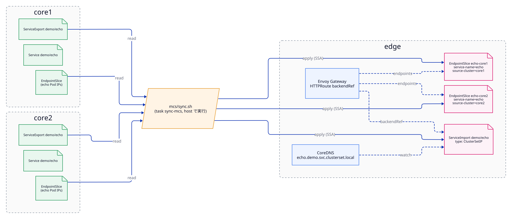

# MCS（Multi-Cluster Services）

- ステータス: `Draft`
- テストラベル: `mcs`
- 関連: [envoy-gateway.md](envoy-gateway.md)（ServiceImport の利用者）、[network.md](network.md)（Pod IP のフラットな到達性）

## 1. 概要

KEP-1645 の MCS API [M-1] を使って、core クラスタの Service を edge から見えるようにする。

- core 側: `ServiceExport` で公開する。
- edge 側: `ServiceImport` と EndpointSlice として受ける。

クラスタ間の Pod IP はファブリックで直接届く（[network.md](network.md)）。そのため、MCS が担うのはサービスディスカバリ（ServiceImport、EndpointSlice、DNS）だけで、データプレーンは持たない。



---

## 2. 設計

### 2.1 構成要素

| 構成要素 | 入れるクラスタ | 備考 |
|---|---|---|
| mcs-api の CRD（`ServiceExport` / `ServiceImport`） | 全クラスタ | [M-2] の `config/` |
| mcs-api-controller | 全クラスタ（Namespace `mcs-system`） | [M-2] の `controllers/`。役割は 5 章で確定する |
| CoreDNS の `multicluster` オプション | 全クラスタ | `clusterset.local` ゾーン [M-6] |
| 同期スクリプト `mcs/sync.sh` | host で実行 | `task sync-mcs` から呼ぶ |
| サンプル app `demo/echo` | edge、core1、core2 | 応答にクラスタ名とノード名を含める。core では ServiceExport を付ける |

### 2.2 同期（sync.sh）

mcs-api のリファレンス実装には、クラスタ間で ServiceExport から ServiceImport と EndpointSlice へ伝搬する syncer がない。そのため、ベースではスクリプトで同期する。コントローラ化は Non-Goal（[README.md](README.md)）。

`sync.sh` の動作:

1. core1 と core2 から、`ServiceExport` が付いた Service と、その EndpointSlice を読む。
2. edge に `ServiceImport`（`type: ClusterSetIP`、ports は Service と同じ）を作る。
3. edge に、クラスタごとの EndpointSlice を作る。
   - 名前: `<service>-<cluster>`（例: `echo-core1`）
   - ラベル:
     - `multicluster.kubernetes.io/service-name: <service>`
     - `multicluster.kubernetes.io/source-cluster: <cluster>`
     - `endpointslice.kubernetes.io/managed-by: mcs-gateway-sync`
   - endpoints: core の Pod IP（ready のものだけ）
4. 対応する export が消えた ServiceImport と EndpointSlice は削除する。

- 何度実行しても同じ結果になる（冪等）。
- `kubectl apply --server-side` で書き込む。

### 2.3 DNS

- CoreDNS 1.12.2 以降では、標準の `kubernetes` プラグインに `multicluster` オプションがある [M-6][C-19]。
- Corefile の変更:
  ```
  kubernetes cluster.local clusterset.local in-addr.arpa ip6.arpa {
      multicluster clusterset.local
      ...
  }
  ```
- CoreDNS の ServiceAccount に、`serviceimports.multicluster.x-k8s.io` を list と watch できる ClusterRole と ClusterRoleBinding を足す [C-19]。
- 期待する解決結果: `echo.demo.svc.clusterset.local` → ServiceImport の IP（ClusterSetIP）。ClusterSetIP を誰が払い出すかは、mcs-api-controller の役割と合わせて確定する（5 章）。

---

## 3. 配置するファイル

```
kindcluster/mcs-gateway/
├── mcs/
│   ├── crds/                 # ServiceExport / ServiceImport
│   ├── controller/           # mcs-api-controller
│   ├── coredns/              # Corefile パッチ、RBAC
│   └── sync.sh
└── sample/
    ├── echo.yaml             # Deployment + Service（全クラスタ共通）
    └── serviceexport.yaml    # core のみ
```

Taskfile のタスク: `deploy-mcs`、`deploy-sample`、`sync-mcs`

---

## 4. テスト仕様（`mcs`）

| # | 確かめること | 観測方法 | 期待値 |
|---|---|---|---|
| mcs-01 | CRD | `kubectl get crd`（3 コンテキスト） | `serviceexports` と `serviceimports` がある |
| mcs-02 | ServiceExport の状態 | core1、core2 の `serviceexport demo/echo` | 存在し、conditions が正常 |
| mcs-03 | ServiceImport | edge の `serviceimport demo/echo` | 存在し、port 8080 を持つ |
| mcs-04 | EndpointSlice | edge で `-l multicluster.kubernetes.io/service-name=echo` | core1 と core2 の 2 つがあり、endpoints が各クラスタの echo Pod IP と一致する |
| mcs-05 | DNS | edge の Pod で `echo.demo.svc.clusterset.local` を引く | 名前解決できる |
| mcs-06 | 接続 | edge の Pod から mcs-05 の名前で HTTP | 成功し、応答のクラスタ名が core1 か core2 |
| mcs-07 | 追従 | core1 の echo のレプリカ数を変えて `task sync-mcs` | edge の `echo-core1` の endpoints の数が一致する |
| mcs-08 | 冪等性 | `task sync-mcs` を 2 回実行する | 2 回目で何も変化しない |

---

## 5. 未確定事項

- **mcs-api-controller の役割:** ServiceImport から derived Service を作るのか、ClusterSetIP を払い出すのか。それによって、sync.sh で何をするか、DNS がどの IP を返すかが決まる [M-2]。
- **CoreDNS のバージョン:** 固定した kindest/node に同梱される CoreDNS が 1.12.2 以上か。足りなければ CoreDNS のイメージだけを上げる。
- **Envoy Gateway との整合:** sync.sh が作る EndpointSlice のラベルが、Envoy Gateway の解決方法と合っているか（[envoy-gateway.md](envoy-gateway.md) 5 章）。

---

## 6. 参考文献

[M-1]〜[M-9] [C-19] [E-3] [E-7]（[references.md](references.md)）
