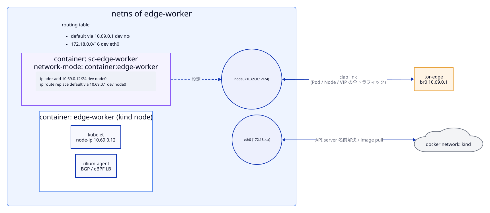
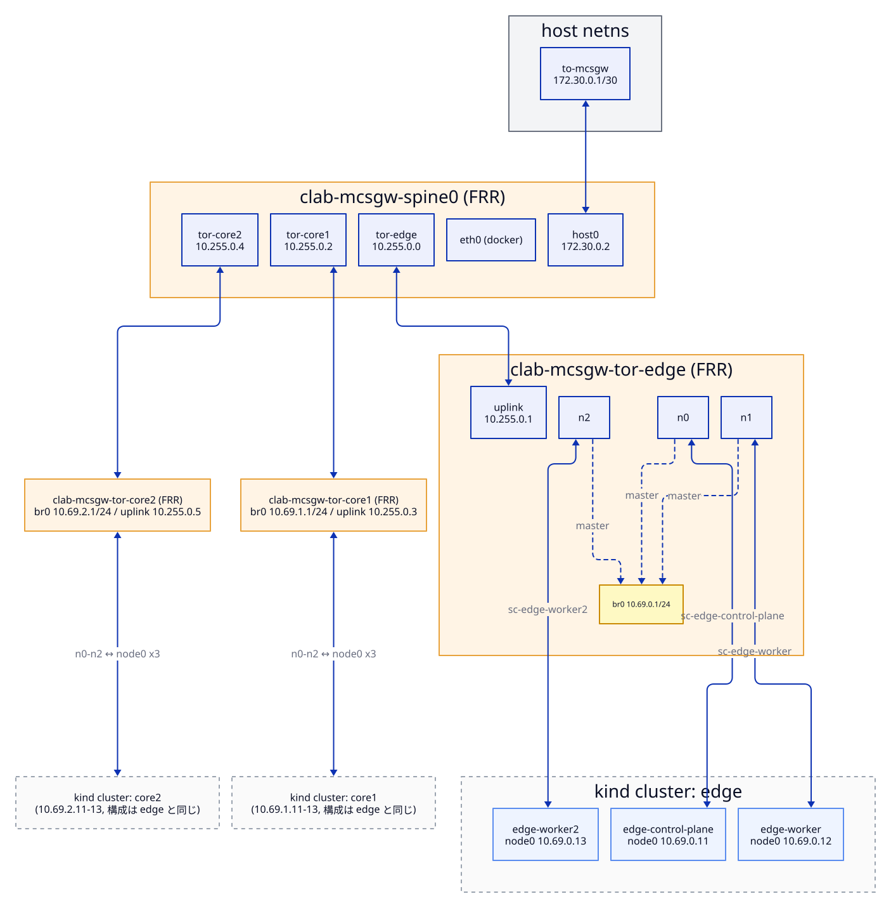

# ネットワーク（containerlab / kind / FRR）

- ステータス: `Draft`
- テストラベル: `fabric`
- 関連: [cilium.md](cilium.md)（Cilium 側の BGP）、[operations.md](operations.md)（起動手順）

## 1. 概要

containerlab のトポロジ 1 つ（lab 名 `mcsgw`）の中に、次のものを置く。

- kind クラスタ 3 つ（`edge`、`core1`、`core2`。各 1 control-plane + 2 worker）
- FRR の spine 1 台（`spine0`）と ToR 3 台（`tor-edge`、`tor-core1`、`tor-core2`）
- 各 kind ノードの sidecar
- host への veth

ネットワークは spine/ToR の 2 段で、全区間を eBGP でつなぐ。1 クラスタに 1 ToR を割り当て、クラスタ内のノードは ToR の L2 bridge（`br0`）にぶら下がる。

---

## 2. 設計

### 2.1 kind クラスタと containerlab の統合

- 各クラスタを containerlab の `k8s-kind` ノード（`startup-config: kind/<cluster>.kind.yaml`）として定義する。containerlab が kind クラスタを作る [L-1]。
- kind が作るノードコンテナ（`<cluster>-control-plane`、`<cluster>-worker`、`<cluster>-worker2`）は、`ext-container` として定義する。こうするとリンクの端点に使える [L-2]。neco-apps-lite と同じ方式 [I-2]。
- 各 kind ノードには sidecar（`kind: linux`、`network-mode: container:<kind ノード名>`）を置く [L-4]。ToR とのリンクはこの sidecar に張り、kind ノードの netns に `node0` を生やす。sidecar の `exec` で次を設定する。
  ```
  ip addr add <node IP>/24 dev node0
  ip route replace default via <ToR GW> dev node0
  ```
- `eth0`（docker の `kind` ネットワーク）は、API server の名前解決と到達、イメージ pull にだけ使う。ノード、Pod、VIP の通信はすべて `node0` 経由にする。



トポロジ全体のリンクとインターフェース:



### 2.2 kind の設定

各 `kind/<cluster>.kind.yaml` の内容 [K-1][I-3]:

- `networking.disableDefaultCNI: true`
- `networking.kubeProxyMode: none`
- `networking.podSubnet` と `networking.serviceSubnet` は 3 章の値にする。
- ノードごとの `kubeadmConfigPatches` で、kubelet の `node-ip` を `node0` のアドレスに固定する。
  - control-plane では `InitConfiguration` の `localAPIEndpoint.advertiseAddress` も同じアドレスにする。
  - これで Node の `INTERNAL-IP` が 10.69.x.x になる。

### 2.3 FRR

- **ToR**:
  - Linux bridge `br0` に GW アドレス（.1）を持たせ、ノード向けの IF（`n0`〜`n2`）を `br0` に入れる [I-2]。
  - ノードは動的ネイバー（`bgp listen range <node subnet> peer-group NODES`、`remote-as external`）として eBGP で受ける [F-1]。
  - spine とは eBGP で張る。デフォルト経路は spine への static にする。
  - 同じ LB VIP を複数ノードから受けるので、`maximum-paths` で ECMP にする。
- **spine**:
  - 全 ToR と eBGP で張る。
  - `eth0` から MASQUERADE してインターネットへ出す。ノードのデフォルト経路が node0 を向くため、イメージ pull 以外の外向き通信はここを通る。
    ```
    iptables -t nat -A POSTROUTING -s 10.69.0.0/16  -o eth0 -j MASQUERADE
    iptables -t nat -A POSTROUTING -s 10.100.0.0/14 -o eth0 -j MASQUERADE
    ```
- 設定は `frr/<router>.conf` に置き、containerlab の `binds` で `/etc/frr/frr.conf` にマウントする。

ToR の雛形（tor-edge の例）:

```
router bgp 65100
 bgp router-id 10.255.0.1
 no bgp ebgp-requires-policy
 bgp bestpath as-path multipath-relax
 neighbor NODES peer-group
 neighbor NODES remote-as external
 bgp listen range 10.69.0.0/24 peer-group NODES
 neighbor 10.255.0.0 remote-as 65000
 address-family ipv4 unicast
  redistribute connected
  maximum-paths 8
 exit-address-family
!
ip route 0.0.0.0/0 10.255.0.0
```

### 2.4 経路の流れ


- Cilium の BGP は経路の広報だけをする。受け取った経路はカーネルに入れない。そのため他クラスタ宛ての通信は、ノードのデフォルト経路（node0 → ToR）で運ぶ。
- 同じクラスタ内のノード間は同一 L2（br0）なので、Cilium の `autoDirectNodeRoutes` で足りる（[cilium.md](cilium.md)）。
- 同じクラスタのノードは同じ ASN を使う。そのため、ToR から自クラスタの経路が返ってきても AS_PATH ループとして捨てられる。カーネルに入れないので実害はない。

### 2.5 host との接続

- containerlab の host リンク（`host:to-mcsgw` と `spine0:host0`）で、host と spine を veth でつなぐ [L-5]。
- host 側の IP と経路は Taskfile が設定する。neco-apps-lite では clab の host exec が効かなかったため、同じ方式にしている [I-5]。
  ```
  ip addr add 172.30.0.1/30 dev to-mcsgw
  ip route add 10.69.0.0/16 via 172.30.0.2 dev to-mcsgw   # ノード
  ip route add 10.80.0.0/14 via 172.30.0.2 dev to-mcsgw   # LB VIP (10.80〜10.83)
  ```

---

## 3. アドレス計画

### 3.1 クラスタごと

| 用途 | edge | core1 | core2 |
|---|---|---|---|
| Node（ToR br0, GW .1） | 10.69.0.0/24 | 10.69.1.0/24 | 10.69.2.0/24 |
| control-plane / worker / worker2 | .11 / .12 / .13 | .11 / .12 / .13 | .11 / .12 / .13 |
| Pod（CiliumPodIPPool `default`） | 10.100.0.0/16 | 10.101.0.0/16 | 10.102.0.0/16 |
| Service（kind serviceSubnet） | 10.110.0.0/16 | 10.111.0.0/16 | 10.112.0.0/16 |
| LB IPAM pool | 10.80.0.0/24 | 10.81.0.0/24 | 10.82.0.0/24 |
| Cilium ASN（ノード） | 65101 | 65201 | 65301 |
| ToR ASN | 65100 | 65200 | 65300 |

### 3.2 ファブリック

| 区間 | CIDR | spine 側 | 相手側 |
|---|---|---|---|
| spine0 ↔ tor-edge | 10.255.0.0/31 | .0 | .1 |
| spine0 ↔ tor-core1 | 10.255.0.2/31 | .2 | .3 |
| spine0 ↔ tor-core2 | 10.255.0.4/31 | .4 | .5 |
| spine0 ↔ host | 172.30.0.0/30 | .2 (`host0`) | .1 (`to-mcsgw`) |

### 3.3 方針

- **Pod CIDR と Service CIDR はクラスタ間で重ならないようにする。** MCS のフラットな L3 到達はこの前提に依存する。
- kind の `podSubnet` は IPAM には使わない（Pod IP は Cilium の multi-pool IPAM が払い出す）。混乱しないよう、CiliumPodIPPool と同じ値をそろえて書く。
- 追加の Pod プールは、`10.103.0.0/16` 以降から取る。

---

## 4. インターフェースと命名

| 対象 | 名前 |
|---|---|
| containerlab の lab 名 | `mcsgw`（コンテナ名は `clab-mcsgw-<node>`） |
| ルータ | `spine0`, `tor-edge`, `tor-core1`, `tor-core2` |
| kind クラスタ | `edge`, `core1`, `core2` |
| kind ノードのコンテナ | `<cluster>-control-plane`, `<cluster>-worker`, `<cluster>-worker2` |
| sidecar | `sc-<kind ノード名>`（例: `sc-edge-worker`） |
| ノード側の IF | `node0` |
| ToR の IF | 上り `uplink`、ノード向け `n0`〜`n2`、bridge `br0` |
| spine の IF | `tor-edge`, `tor-core1`, `tor-core2`, `host0` |
| host の IF | `to-mcsgw` |

---

## 5. 配置するファイル

```
kindcluster/mcs-gateway/
├── topology.clab.yaml
├── kind/{edge,core1,core2}.kind.yaml
└── frr/{spine0,tor-edge,tor-core1,tor-core2}.conf
```

Taskfile のタスク: `deploy-fabric`。`start` と `stop` からも呼ばれる。

---

## 6. テスト仕様（`fabric`）

| # | 確かめること | 観測方法 | 期待値 |
|---|---|---|---|
| fabric-01 | spine と全 ToR の BGP | `vtysh -c 'show bgp summary json'`（spine0） | 3 ピアがすべて Established |
| fabric-02 | ノードの node0 | 各ノードで `ip -j addr show node0` | 3 章の IP が付いている |
| fabric-03 | ノードのデフォルト経路 | 各ノードで `ip -j route show default` | via が ToR GW、dev が `node0` |
| fabric-04 | ノードから GW への到達性 | 各ノードから ToR GW へ `ping` | 成功する |
| fabric-05 | クラスタ間のノード到達性 | edge-worker から core1-worker、core2-worker の node0 IP へ `ping` | 成功する（spine 経由） |
| fabric-06 | host から spine への到達性 | host から 172.30.0.2 へ `ping` | 成功する |
| fabric-07 | host からノードへの到達性 | host から各ノードの node0 IP へ `ping` | 成功する |
| fabric-08 | Node の INTERNAL-IP | `kubectl get node -o json`（3 コンテキスト） | 10.69.x.x になっている |
| fabric-09 | 冪等性 | `task start` を 2 回実行する | 2 回目もエラーにならず、fabric-01〜fabric-08 が成り立つ |
| fabric-10 | 後片付け | `task stop` の後に `docker ps`、`ip link`、`ip route` を見る | `clab-mcsgw-*`、kind ノード、`to-mcsgw`、追加した経路が残っていない |

fabric-09 と fabric-10 は Ginkgo ではなく、[development.md](development.md) の再現性確認の手順で確かめる。

---

## 7. 未確定事項

- `k8s-kind` を 3 つ並べたときの挙動。`extras.k8s_kind.deploy.wait` と、kubeconfig の扱い。
- containerlab の `deploy --reconfigure` を使ったときに、kind クラスタが作り直されるか。冪等性（fabric-09）をどう実現するか。

---

## 8. 参考文献

[I-2] [I-3] [I-4] [I-5] [I-10] [L-1]〜[L-9] [K-1]〜[K-3] [F-1]〜[F-3] [R-1] [R-2]（[references.md](references.md)）
